```{r}
#| label: packages
#| include: false
library(readxl)
library(dplyr)
library(tidyr)
library(purrr)
library(stringr)
library(ggplot2)
library(patchwork)
library(visdat)
library(GGally)
library(gt)
library(PKNCA)
```

```{r}
#| label: data-load
#| include: false
raw_file   <- "data/raw/datIW1PMX001_toClean.xlsx"
clean_file <- "data/clean/datIW1PMX001_CLEAN.xlsx"  
```

```{r}
#| label: settings
#| include: false
route_cols <- c(IV = "#1b6ca8", Oral = "#d1495b")
theme_set(theme_bw(base_size = 11) +
            theme(panel.grid.minor = element_blank(),
                  strip.background = element_rect(fill = "grey92", colour = NA)))

# fixing labels on log scales (0.001 instead of 1e-03)
log_lab <- scales::label_number(drop0trailing = TRUE)
```

```{r}
#| label: compute-early
#| include: false
#| ref.label: ["load-data", "derived", "run-nca", "ka-and-f"]
```

# Introduction

## Compound rationale and clinical pharmacology of tamoxifen

Tomovicen is a novel tamoxifen-like prodrug developed to address three limitations of tamoxifen: its dependence on CYP2D6 for activation, its long half-life and its high interindividual variability in pharmacokinetics (PK) and pharmacodynamics (PD). Because Tomovicen shares tamoxifen's structure and mechanism of action, the clinical pharmacology of tamoxifen is summarised below as the reference for this study.

### ADME profile of Tamoxifen

::: panel-tabset
### Absorption

Tamoxifen is rapidly absorbed after oral administration, with a time to maximum concentration (tmax) of 4–7 h and a concentration max of 40ng/mL for an oral dose of 20mg. At steady state, reached after about three months of 20 mg/day, plasma concentrations are approximately 122 ng/mL for tamoxifen and 353 ng/mL for N-desmethyltamoxifen.

### Distribution

The distribution half-life is 7–14 h, and tamoxifen is more than 99% bound to plasma proteins, mainly serum albumin. The volume of distribution of the compound is approximately 50-60L/kg.

### Metabolism

Tamoxifen is extensively metabolised by hydroxylation, demethylation and conjugation (@fig-tamoxifen-metabolism). The main pathway is N-demethylation by CYP3A4/5 to N-desmethyltamoxifen, the major circulating metabolite, which is then converted by CYP2D6 to 4-hydroxy-N-desmethyltamoxifen (endoxifen). A minor route converts tamoxifen to 4-hydroxytamoxifen, mainly through CYP2D6, and 4-hydroxytamoxifen can in turn be converted to endoxifen by CYP3A4/5. Both hydroxylated metabolites are later inactivated by sulfation (SULT1A1) and glucuronidation (UGTs) and excreted.

.](images/tamoxifen-metabolism.png){#fig-tamoxifen-metabolism width="90%"}

CYP2D6 is therefore the key enzyme for activation. The *CYP2D6* gene is highly polymorphic, with more than 100 known variants as well as frequent gene duplications and deletions. In CYP2D6 poor metabolisers, endoxifen concentrations are about 75% lower, and a similar reduction is seen when strong CYP2D6 inhibitors are co-administered ([Cronin-Fenton & Damkier, 2018](https://doi.org/10.1016/bs.apha.2018.03.001)).

### Elimination

Elimination is slow. The terminal elimination half-life is 5 to 7 days for tamoxifen and about 14 days for N-desmethyltamoxifen. Excretion is mainly faecal, with minor urinary excretion of unchanged drug and metabolites, and enterohepatic recirculation is likely (tamoxifen Summary of Product Characteristics).
:::

### Pharmacodynamic of Tamoxifen

::: panel-tabset
## Mechanism of action

Tamoxifen (ATC code L02BA01) is a non-steroidal selective oestrogen receptor modulator (SERM) with a triphenylethylene structure. It exerts tissue-specific effects: it acts as an oestrogen-receptor (ER) antagonist in breast tissue, where it competitively blocks oestrogen binding to its receptor, and as a partial agonist in the endometrium, bone and liver. This partial agonism explains its beneficial effects on bone mass maintenance and lipid profile (reduction in total and LDL cholesterol) in postmenopausal women, as well as its endometrial and thromboembolic adverse effects. Tamoxifen is considered a prodrug: its metabolites 4-hydroxytamoxifen and endoxifen have a 30-100 times higher ER affinity than the parent compound, and since endoxifen reaches markedly higher plasma concentrations than 4-hydroxytamoxifen, it is regarded as the main active metabolite.(RCP)

## Indication and dosage

Tamoxifen is indicated for the adjuvant treatment of ER-positive early breast cancer after surgery in pre- and postmenopausal women (for 5 years), for ER-positive metastatic or advanced breast cancer, and for male breast cancer. The standard dose is 20 mg/day orally, given once daily or as 10 mg twice daily.(RCP)

## Adverse effects

Common adverse effects are hot flushes and other vasomotor symptoms, mood changes, vaginal dryness and menstrual irregularities. Rare but severe reactions include depression, venous thromboembolism, endometrial cancer and stroke. (RCP)

## Drug interaction

Tamoxifen is primarily metabolised by CYP3A4 (N-demethylation) and CYP2D6 (formation of endoxifen). Strong CYP2D6 inhibitors (e.g. paroxetine, fluoxetine, quinidine, bupropion) reduce endoxifen plasma concentrations by 65-75% and may decrease efficacy, so their co-administration should be avoided whenever possible. CYP3A4 inducers such as rifampicin lower tamoxifen plasma levels, although the clinical relevance remains uncertain. Pharmacodynamic interactions include potentiation of the anticoagulant effect of coumarin derivatives (e.g. warfarin), an increased risk of thromboembolic events with concomitant cytotoxic agents, and additive QTc prolongation with other QT-prolonging drugs.(RCP)
:::

### Biomarkers

Pharmacodynamic biomarkers include a reduction in mammographic density (a decrease of 10–20% or more is associated with better outcome), an increase in sex hormone-binding globulin (SHBG) and a decrease in insulin-like growth factor 1 (IGF-1). Exposure and pharmacogenetic markers include the endoxifen plasma concentration, for which a threshold of about 5.97 ng/mL (about 16 nM) has been proposed, and the CYP2D6 genotype or activity score.

### Influencing factors

Three groups of factors influence tamoxifen exposure and response:

::: panel-tabset
## Genetics

CYP2D6 is the main factor, with poor metabolisers showing about 75% lower endoxifen. CYP3A4/5, CYP2C9, CYP2C19, SULT1A1, UGT2B7 and ABCB1 also contribute; this work focuses on CYP2D6.

| Allele of CYP2D6 | Function                    | Activity score |
|------------------|-----------------------------|----------------|
| \*1              | Normal function             | 1              |
| \*2              | Normal function             | 1              |
| \*3              | No function (frameshift)    | 0              |
| \*5              | No function (gene deletion) | 0              |

## drug-drug interactions

Strong CYP2D6 inhibitors (paroxetine, fluoxetine, bupropion, quinidine) lower endoxifen and therefore the active drug, while moderate inhibitors such as duloxetine have a smaller effect. CYP3A inducers such as rifampicin lower overall exposure.

## patient factors

Adherence, menopausal status, age, body mass index (BMI) and prior thrombotic risk.
:::

### Implications for PK modelling

Three features of tamoxifen shape the modelling approach. The long half-lives mean that steady state is reached slowly, over several weeks. Interindividual variability is high because of CYP2D6 polymorphism and drug–drug interactions. Finally, efficacy depends on active metabolites, which calls for a parent–metabolite

## Drug development context

Having completed preclinical development, the investigational compound now enters clinical development with a Phase I bioavailability study: a 2×2 crossover trial comparing oral and intravenous (IV) administration. @tbl-dev-phases places this study in the drug development life cycle and contrasts the data generated in each phase.

| Phase    | Population                  | Objectives                                | Typical data                                |
|:---------|:----------------------------|:------------------------------------------|:--------------------------------------------|
| I        | Healthy volunteers (20–100) | Safety, tolerability, PK, bioavailability | Dense PK sampling, safety, early biomarkers |
| II       | Patients (100–300)          | Dose finding, exposure–response           | Sparse PK, PD, preliminary efficacy         |
| III      | Large patient population    | Efficacy, safety                          | Clinical outcomes, adverse events, sparse PK|
| IV       | Real-world patients         | Long-term safety, effectiveness           | Pharmacovigilance, registries               |

: Phases of clinical drug development and the data generated in each. {#tbl-dev-phases}

Phase I is conducted in healthy volunteers and generates dense PK and safety data, whereas Phases II and III are conducted in patients and focus on dose–response and efficacy, with only sparse PK sampling. The present study is designed as follows:

- The IV arm is the reference (100% availability) and allows clearance and volume of distribution to be estimated.
- The oral arm reflects the intended clinical route.
- Comparing both arms gives the absolute bioavailability (F) and the absorption rate, which guide dose selection for Phase II.
- The crossover design lets each subject serve as their own control, which reduces between-subject variability, and a washout period between periods avoids carry-over.

## Pharmacokinetic and pharmacodynamic challenges of tamoxifen

::: panel-tabset
### PK challenges

1.  **Prodrug requiring bioactivation:** endoxifen, the main active metabolite, is formed in two steps by CYP3A4 and CYP2D6.
2.  **High interindividual variability:** CYP2D6 polymorphism strongly affects exposure.
3.  **Drug–drug interactions:** strong CYP2D6 inhibitors lower endoxifen; CYP3A4 inducers lower overall exposure.
4.  **Long half-lives and enterohepatic recirculation:** about 7 days for tamoxifen and 14 days for N-desmethyltamoxifen, so steady state takes weeks, dose changes act slowly and recirculation complicates modelling.
5.  **Oral-only use and high protein binding:** tamoxifen is \>99% albumin-bound and given only orally; without an IV reference, absolute bioavailability, clearance and volume of distribution cannot be separated.

### PD challenges

1.  **Mixed receptor activity (SERM):** ER antagonist in breast tissue but partial agonist in endometrium, bone and liver, which explains both efficacy and adverse effects.
2.  **Dependence on active metabolites:** endoxifen and 4-hydroxytamoxifen have 30–100× higher ER affinity than the parent, so response depends on metabolic activation rather than on the dose given.
3.  **High interindividual variability in response:** driven by CYP2D6 metaboliser status and ethnicity.
4.  **Resistance and adherence:** primary or acquired resistance (HER2 amplification, PI3K/AKT/mTOR and growth-factor pathway activation) and frequent discontinuation due to adverse effects reduce effectiveness.
5.  **Poorly defined therapeutic window:** the proposed endoxifen threshold (\~5.97 ng/mL) is controversial, and serious adverse effects increase with exposure and treatment duration, making dose individualisation difficult.
:::

# Data management and curation {#sec-data}

## Data source and study design

```{r}
#| label: load-data
#| include: false
# Raw workbook: 12 sheets, one per participant, read as text so that no value is silently coerced
raw <- excel_sheets(raw_file) |>
  map_df(~ read_excel(raw_file, sheet = .x, col_types = "text") |> mutate(sheet = .x))

# Typed audit copy of the raw file (the source file is never modified)
typed <- raw |>
  mutate(row = row_number(),
         across(c(ALB, CREAT, CRP), ~ as.numeric(str_replace(.x, ",", "."))),
         CONC_flag = if_else(CONC == "<LLOQ", "<LLOQ", "Quantified"),
         DOSE_flag = DOSE == "+/-500",
         CONC = suppressWarnings(as.numeric(CONC)),
         DOSE = suppressWarnings(as.numeric(DOSE)),
         across(c(ID, TIME, WEEK, RATE, EVID, OCC, WT, SEX, AGE, eGFR, CYP_2D6), as.numeric))
obs_raw <- typed |> filter(EVID == 0)

# cleaned analysis dataset
pk <- read_excel(clean_file)
subj_clean <- pk |> distinct(ID, WT, SEX, AGE, ALB, CREAT, eGFR, CRP, CYP_2D6, ethnicity)
```

The study was a two-sequence, two-period crossover in `r n_distinct(pk$ID)` participants. Each participant received `r dose_iv_mg` mg Tomovicen once as a `r signif(infusion_h, 3)` h IV infusion (`r unique(dose_iv$RATE)` mg/h) and once orally, separated by a washout of undocumented length. Plasma concentrations were measured at `r n_distinct(pk$TIME[pk$EVID == 0 & pk$Administration == "Oral"])` time points from 0.5 to 96 h after each dose (plus a pre-dose sample before the IV dose). The raw data were supplied as one Excel sheet per participant (`r nrow(raw)` records, `r ncol(raw) - 1` variables) together with a variable definition file.

::: {.panel-tabset}

### Design

```{r}
#| label: tbl-design
#| tbl-cap: "Crossover allocation and sampling."
pk |>
  distinct(ID, OCC, Administration) |>
  pivot_wider(names_from = OCC, values_from = Administration, names_prefix = "p") |>
  mutate(Sequence = paste(p1, "→", p2)) |>
  group_by(Sequence) |>
  summarise(Participants = n(), IDs = paste(sort(ID), collapse = ", "), .groups = "drop") |>
  mutate(`Samples per period` = if_else(str_starts(Sequence, "IV"), "18 (IV) / 17 (oral)", "17 (oral) / 18 (IV)")) |>
  gt()
```

### Variables

```{r}
#| label: tbl-dictionary
#| tbl-cap: "Variables, units and definitions"
tribble(
  ~Variable, ~Unit, ~Definition, ~Type,
  "ID", "-", "Participant identifier", "Identifier",
  "TIME", "h", "Time since dose within the occasion", "Design",
  "WEEK", "week", "Study week", "Design",
  "AMT (raw: DOSE)", "mg", "Administered dose", "Design",
  "RATE", "mg/h", "IV infusion rate", "Design",
  "EVID", "-", "0 = observation, 1 = dose, 4 = reset and dose", "Design",
  "OCC", "-", "Study period (1 or 2)", "Design",
  "Administration", "-", "IV or Oral", "Design",
  "CONC", "mg/L", "Plasma concentration of Tomovicen", "Outcome",
  "WT", "kg", "Body weight", "Covariate",
  "SEX", "-", "0 = female, 1 = male", "Covariate",
  "AGE", "years", "Age", "Covariate",
  "ALB", "g/L", "Serum albumin", "Covariate",
  "CREAT", "mg/dL", "Serum creatinine", "Covariate",
  "eGFR", "mL/min/1.73 m²", "Estimated glomerular filtration rate", "Covariate",
  "CRP", "mg/L", "C-reactive protein", "Covariate",
  "CYP_2D6", "-", "CYP2D6 subtype (codes 1, 2, 3, 5; no code book supplied)", "Covariate",
  "ethnicity", "-", "Self-reported ethnicity", "Covariate") |>
  gt(groupname_col = "Type")
```

:::

## Data quality assessment

The raw file was checked for missing or non-numeric entries, duplicated records, unusual concentration profiles, covariates that change within a participant, and dose records or sampling times that do not match the study design. @tbl-issues summarises the findings; the evidence for each is shown in the tabs below.

```{r}
#| label: tbl-issues
#| tbl-cap: "Anomalies identified in the raw dataset."
tribble(
  ~Severity, ~Anomaly, ~Evidence, ~Participants,
  "Critical", "Duplicated participant", "Identical covariates and 35/35 identical concentrations", "ID2, ID6",
  "Critical", "Concentrations on the wrong scale", "Cmax 100-fold (ID2, ID6) and 1000-fold (ID7) below the other participants; normal profile shape", "ID2, ID6, ID7",
  "Major", "Text in the concentration column", "22 '<LLOQ' entries: 20 from the low-scale profiles of ID7, 2 mid-profile in ID1 (between 49 and 37 mg/L)", "ID1, ID7",
  "Major", "Invalid dose records", "Dose recorded as 0 mg or '+/-500' instead of 500 mg", "ID1, ID3, ID12",
  "Major", "Invalid or inconsistent sex", "Undefined code 2; sex changes within the profile", "ID8, ID10, ID11, ID12",
  "Minor", "Decimal commas", "Albumin, creatinine and CRP partly stored as text (e.g. '43,9')", "All",
  "Minor", "Undocumented coding", "CYP2D6 codes without code book; WEEK = 1 in both periods; EVID 4 always on oral doses", "All",
  "Minor", "Naming and free text", "DOSE vs AMT; undocumented NOTES column with handling remarks", "6 participants") |>
  gt(groupname_col = "Severity") |> 
  tab_style(cell_text(weight = "bold"), cells_row_groups())
```

::: {.panel-tabset}

### Missing and non-numeric data

```{r}
#| label: fig-missing
#| fig-cap: "Missing values in the raw file. Missing cells arise only from '<LLOQ' (CONC) and '+/-500' (DOSE) entries."
#| fig-height: 3.4
vis_miss(typed |> 
        select(ID, TIME, DOSE, RATE, EVID, CONC, OCC, WT, SEX, AGE, ALB, CREAT, eGFR, CRP, CYP_2D6, ethnicity)) +
        theme(axis.text.x = element_text(angle = 60, size = 8))
```

```{r}
#| label: fig-lloq
#| fig-cap: "Location of '<LLOQ' entries in the raw concentration data."
#| fig-height: 3.4
ggplot(obs_raw, aes(factor(TIME), factor(ID, levels = 12:1), fill = CONC_flag)) +
  geom_tile(colour = "white") +
  scale_fill_manual(values = c(Quantified = "grey85", `<LLOQ` = "firebrick")) +
  facet_wrap(~ Administration) +
  labs(x = "Time (h)", y = "Participant", fill = NULL) +
  theme(axis.text.x = element_text(angle = 90, vjust = 0.5, size = 7))
```

```{r}
#| label: tbl-nonnumeric
#| tbl-cap: "Raw cells that cannot be read as numbers."
num_cols <- c("TIME", "WEEK", "DOSE", "RATE", "EVID", "CONC", "OCC", "WT", "SEX", "AGE", "ALB", "CREAT", "eGFR", "CRP", "CYP_2D6")
raw |>
  pivot_longer(all_of(num_cols), values_transform = as.character) |>
  filter(!is.na(value), is.na(suppressWarnings(as.numeric(value)))) |>
  mutate(Problem = case_when(str_detect(value, ",") ~ "Decimal comma",
                             value == "<LLOQ" ~ "'<LLOQ' text",
                             TRUE ~ paste0("Invalid entry '", value, "'"))) |>
  group_by(Variable = name, Problem) |>
  summarise(Cells = n(), Participants = n_distinct(ID), .groups = "drop") |>
  gt()
```

The missing values are not spread at random and come from only two participants. For ID7, the concentrations were recorded too low, so many values fell below the detection limit. These values are missing because of the scale error, not because the drug level was truly too low to measure. For ID1, the two missing values sit between measured values of about 49 and 37 mg/L. On a falling concentration curve, a value cannot drop below the detection limit and then rise again, so these entries are most likely recording errors (@fig-id1-lloq).

```{r}
#| label: fig-id1-lloq
#| fig-cap: "Raw IV profile of ID1 over the first 24 h (semi-log scale). Dashed lines mark the two '<LLOQ' entries, which fall between quantified values of 48.7 and 37.2 mg/L on a steadily declining curve."
#| fig-height: 3.4
id1_iv <- obs_raw |> filter(ID == 1, Administration == "IV", TIME > 0, TIME <= 24)
ggplot(filter(id1_iv, !is.na(CONC)), aes(TIME, CONC)) +
  geom_vline(xintercept = id1_iv$TIME[id1_iv$CONC_flag == "<LLOQ"], linetype = 2, colour = "firebrick") +
  geom_line() +
  geom_point() +
  scale_y_log10(labels = log_lab) +
  labs(x = "Time after IV dose (h)", y = "Concentration (mg/L)")
```

### Duplicated participant

```{r}
#| label: fig-duplicate
#| fig-cap: "Concentrations of ID6 against ID2 in the raw file (log scales). All points lie on the identity line."
#| fig-height: 3.4
id26 <- obs_raw |>
  filter(ID %in% c(2, 6)) |>
  select(ID, Administration, TIME, CONC) |>
  pivot_wider(names_from = ID, values_from = CONC, names_prefix = "ID")
ggplot(id26, aes(ID2, ID6, colour = Administration)) +
  geom_abline(linetype = 2, colour = "grey50") +
  geom_point(size = 2) +
  scale_x_log10(labels = log_lab) + scale_y_log10(labels = log_lab) + scale_colour_manual(values = route_cols) +
  labs(x = "ID2 concentration (mg/L)", y = "ID6 concentration (mg/L)", colour = NULL)
```

ID6 and ID2 have exactly the same values, for all `r sum(id26$ID2 == id26$ID6, na.rm = TRUE)` measured concentrations and for every covariate. Two different people cannot give identical results, so one of these records must be a copy of the other. The notes column also points to problems with both: ID2's data were copied by hand, and a dilution step for ID6 was never confirmed.

### Concentration outliers

```{r}
#| label: fig-raw-profiles
#| fig-cap: "Individual raw concentration-time profiles (semi-log scale). ID2, ID6 and ID7 lie two to three orders of magnitude below the others."
#| fig-height: 5.5
#| fig-width: 9
ggplot(filter(obs_raw, CONC > 0), aes(TIME, CONC, colour = Administration)) +
  geom_line() + geom_point(size = 0.7) +
  facet_wrap(~ ID, labeller = label_both, nrow = 2) +
  scale_y_log10(labels = log_lab) + scale_colour_manual(values = route_cols) +
  labs(x = "Time (h)", y = "Concentration (mg/L)", colour = NULL)
```

The concentrations of ID2, ID6 and ID7 are much lower than those of the other participants. However, their profiles have a normal shape and the same IV-to-oral peak ratio as everyone else. This may suggest the values were recorded in the wrong unit or with an error, not that these participants handled the drug differently.

### Sex coding

```{r}
#| label: tbl-sex
#| tbl-cap: "Participants with an invalid or changing sex code (0 = female, 1 = male)."
typed |>
  count(ID, SEX) |>
  group_by(ID) |>
  filter(n() > 1 | any(SEX == 2)) |>
  summarise(`Codes in raw file` = paste0(SEX, " (", n, ")", collapse = ", "), .groups = "drop") |>
  left_join(distinct(pk, ID, SEX), by = "ID") |>
  mutate(`Sex in cleaned file` = if_else(SEX == 1, "Male", "Female"), .keep = "unused") |>
  gt()
```

Four participants have either the undefined code 2 or a sex that changes partway through the study (@tbl-sex). IDs 10 and 11 were coded 2 throughout and were recoded as female. IDs 8 and 12 switch between codes and were set to male.

### Doses, design and notes

```{r}
#| label: tbl-doses
#| tbl-cap: "Dose records that deviate from the 500 mg protocol dose."
typed |>
  filter(EVID != 0, is.na(DOSE) | DOSE != 500) |>
  transmute(ID, Period = OCC, Route = Administration, EVID,
            `Recorded dose` = raw$DOSE[row], `Infusion rate (mg/h)` = RATE) |>
  gt()
```

```{r}
#| label: tbl-notes
#| tbl-cap: "Free-text notes recorded in the raw file."
typed |>
  filter(!is.na(NOTES), NOTES != ".") |>
  transmute(ID, Route = Administration, Note = NOTES) |>
  gt()
```

The sampling schedule was identical in all participants (IV: 18 samples including pre-dose; oral: 17 samples without a pre-dose sample). WEEK equals 1 in both periods, so the washout cannot be verified. Several notes could affect data validity (sample left at room temperature, acetaminophen intake, fasting status) and were retained for interpretation.

:::

## Data cleaning

The assessment above was carried out on the raw dataset to find its errors. A cleaned dataset was then provided and used for all analyses. @tbl-cleaning shows how each problem is resolved in the cleaned dataset, @fig-clean-profiles shows the cleaned concentration profiles, and @fig-visdat-clean confirms that the analysis dataset is complete and clean.

::: {.panel-tabset}

### Cleaning summary

```{r}
#| label: tbl-cleaning
#| tbl-cap: "How each problem in the raw data is resolved in the cleaned dataset."
tribble(
  ~Problem, ~Participants, ~`In the cleaned dataset`,
  "Duplicated participant", "ID2", "Copied values replaced by ID2's own concentrations and covariates",
  "Concentrations on the wrong scale", "ID6, ID7", "Multiplied by 100 (ID6) and 1000 (ID7)",
  "'<LLOQ' text in the concentration column", "ID1, ID7", "Replaced by measured concentrations",
  "Invalid dose records", "ID1, ID3, ID12", "Set to the protocol dose of 500 mg",
  "Invalid or changing sex code", "ID8, ID10, ID11, ID12", "Set to the sex that matches the recorded eGFR: ID8 and ID12 male, ID10 and ID11 female",
  "Decimal commas", "All", "Converted to decimal points and stored as numbers",
  "Naming and free text", "All", "DOSE renamed to AMT; NOTES column removed") |>
  gt()
```

### Cleaned profiles

```{r}
#| label: fig-clean-profiles
#| fig-cap: "Individual concentration-time profiles in the cleaned dataset (semi-log scale). All participants now lie in the same range."
#| fig-height: 5.5
#| fig-width: 9
ggplot(filter(pk, EVID == 0, CONC > 0), aes(TIME, CONC, colour = Administration)) +
  geom_line() + geom_point(size = 0.7) +
  facet_wrap(~ ID, labeller = label_both, nrow = 2) +
  scale_y_log10(labels = log_lab) + scale_colour_manual(values = route_cols) +
  labs(x = "Time (h)", y = "Concentration (mg/L)", colour = NULL)
```

### Data types and completeness

```{r}
#| label: fig-visdat-clean
#| fig-cap: "Variable types (left) and completeness (right) of the analysis dataset."
#| fig-height: 3.4
(vis_dat(pk) + theme(axis.text.x = element_text(angle = 60, size = 8))) +
  (vis_miss(pk) + theme(axis.text.x = element_text(angle = 60, size = 8)))
```

:::

## Data formatting

The analysis dataset is one long table in the standard NONMEM format, so it can be used directly in PKNCA, Monolix and NONMEM. Each row is either a dose (EVID 1 or 4) or a concentration measurement (EVID 0) for one participant in one period. TIME starts again at 0 at each dose, and the covariates are repeated on every row.

For the NCA, the data are split into a concentration table and a dose table for each route. The IV infusion lasted AMT/RATE = `r signif(infusion_h, 3)` h. There was no oral sample before dosing, so the oral concentration at time 0 is set to zero.

The NCA results come out with one row per parameter. They are reshaped to one row per participant. Parameters are given route-specific names (for example CL for IV and CL_F for oral) before the IV and oral results are combined.

```{r}
#| label: derived
obs       <- pk |> filter(EVID == 0)
conc_all  <- pk |> filter(EVID %in% c(0, 4)) |> select(ID, OCC, Administration, TIME, CONC)
conc_iv   <- conc_all |> filter(Administration == "IV")
conc_oral <- conc_all |> filter(Administration == "Oral")
dose_iv   <- pk |> filter(Administration == "IV", EVID == 1) |> mutate(duration = AMT / RATE)
dose_oral <- pk |> filter(Administration == "Oral", EVID == 4)
dose_iv_mg <- unique(dose_iv$AMT); dose_oral_mg <- unique(dose_oral$AMT); infusion_h <- unique(dose_iv$duration)
mean_profile <- conc_all |> group_by(Administration, TIME) |> summarise(CONC = mean(CONC), .groups = "drop")
subj_clean <- pk |> distinct(ID, WT, SEX, AGE, ALB, CREAT, eGFR, CRP, CYP_2D6, ethnicity)
```

## Study population and exploratory analysis

```{r}
#| label: tbl-baseline
#| tbl-cap: "Baseline characteristics of the study population (n = 12)."
# Continuous characteristics: one row each with mean (SD) and median [range]
cont_tab <- subj_clean |>
  select(`Age (years)` = AGE, `Weight (kg)` = WT, `eGFR (mL/min/1.73 m²)` = eGFR,
         `Creatinine (mg/dL)` = CREAT, `Albumin (g/L)` = ALB, `CRP (mg/L)` = CRP) |>
  pivot_longer(everything(), names_to = "Characteristic") |>
  group_by(Characteristic = factor(Characteristic, levels = unique(Characteristic))) |>
  summarise(`Mean (SD) or n (%)` = sprintf("%.1f (%.1f)", mean(value), sd(value)),
            `Median [range]` = sprintf("%.1f [%.1f-%.1f]", median(value), min(value), max(value))) |>
  mutate(Characteristic = as.character(Characteristic))

# Categorical characteristics: one row per level with n (%)
cat_tab <- subj_clean |>
  transmute(Sex = if_else(SEX == 1, "Male", "Female"),
            `CYP2D6 subtype` = paste("Code", CYP_2D6),
            Ethnicity = ethnicity) |>
  pivot_longer(everything(), names_to = "Variable", values_to = "Level") |>
  count(Variable = factor(Variable, levels = c("Sex", "CYP2D6 subtype", "Ethnicity")), Level) |>
  transmute(Characteristic = paste0(Variable, ": ", Level),
            `Mean (SD) or n (%)` = sprintf("%d (%.0f%%)", n, 100 * n / nrow(subj_clean)),
            `Median [range]` = "")

bind_rows(cont_tab, cat_tab) |>
  gt()
```

The 12 participants were aged 50 to 64 years (mean 56.8) and weighed 64 to 93 kg (mean 77.6). Mean eGFR was 87.1 mL/min/1.73 m², ranging from 40.5 to 107.5. Eight participants were female and four were male. Each CYP2D6 subtype and each ethnic group included only two to four participants, so any comparison between these groups can only be descriptive.

::: {.panel-tabset}

### Distributions

```{r}
#| label: fig-distributions
#| fig-cap: "Distribution of continuous covariates (histogram with individual values)."
#| fig-height: 3.4
cov_long <- subj_clean |>
  select(ID, `Age (y)` = AGE, `Weight (kg)` = WT, `eGFR` = eGFR, `Creatinine (mg/dL)` = CREAT, `Albumin (g/L)` = ALB, `CRP (mg/L)` = CRP) |>
  pivot_longer(-ID)
ggplot(cov_long, aes(value)) +
  geom_histogram(bins = 7, fill = "grey80", colour = "white") +
  geom_rug(linewidth = 0.6) +
  facet_wrap(~ name, scales = "free", nrow = 1) +
  labs(x = NULL, y = "Participants")
```

```{r}
#| label: tbl-normality
#| tbl-cap: "Shapiro-Wilk test for normality of each covariate. A p-value below 0.05 suggests the values are not normally distributed."

cov_long |>
  group_by(Covariate = name) |>
  summarise(W = shapiro.test(value)$statistic, `p-value` = shapiro.test(value)$p.value, .groups = "drop") |>
  mutate(`Normally distributed?` = if_else(`p-value` < 0.05, "No", "Yes")) |>
  gt() |>
  fmt_number(W, decimals = 2) |>
  fmt_number(`p-value`, decimals = 3) |>
  cols_align(align = "center", columns = c(W, `p-value`, `Normally distributed?`)) |>
  cols_width(`Normally distributed?` ~ px(170))
```

The mean and SD describe a covariate well only when its values are normally distributed. If they are not, the median and range are a better summary. The Shapiro-Wilk test was used to check this (@tbl-normality). Its null hypothesis (H0) is that the data are normally distributed, so a p-value below 0.05 rejects H0 and suggests that the values are not normally distributed. With only 12 participants the test can miss small departures from normality, so the results should be read together with the histograms in @fig-distributions.

Age, weight, albumin and CRP are consistent with a normal distribution (all p > 0.3). Creatinine is not (p = 0.04). eGFR is borderline (p = 0.09). Both are affected by a single participant, ID11, who has the highest creatinine (1.50 mg/dL) and the lowest eGFR (40.5 mL/min/1.73 m²). For this reason, @tbl-baseline reports both the mean (SD) and the median [range] for every covariate.

### Correlations

```{r}
#| label: fig-correlation
#| fig-cap: "Pairwise relationships between baseline covariates."
#| fig-height: 6.5
#| fig-width: 8.5
subj_clean |>
  transmute(Age = AGE, Weight = WT, eGFR, Creatinine = CREAT, Albumin = ALB, CRP,
            Sex = factor(SEX, 0:1, c("F", "M"))) |>
  ggpairs(columns = 1:6, aes(colour = Sex),
          upper = list(continuous = wrap("cor", method = "spearman", size = 3)),
          lower = list(continuous = wrap("points", size = 1.5)),
          diag = list(continuous = wrap("densityDiag", alpha = 0.4)),
          progress = FALSE) +
  theme(axis.text = element_text(size = 7))
```

Most covariates are only weakly related to each other (|ρ| below 0.25). Three pairs show a moderate relationship:

- **Creatinine and eGFR (ρ = −0.65):** participants with higher serum creatinine tended to have lower eGFR. This is expected, because eGFR is calculated from creatinine.
- **Creatinine and weight (ρ = 0.57):** heavier participants tended to have higher creatinine. Creatinine is produced by muscle, and heavier people usually have more muscle mass.
- **Albumin and CRP (ρ = −0.66):** participants with higher CRP tended to have lower albumin. CRP increases during inflammation, while albumin decreases.

Because creatinine and eGFR largely measure the same thing (kidney function), only one of them should be used when testing covariates in a model. With only 12 participants, these relationships should be treated as indications rather than conclusions.

### Cross-tabulations

```{r}
#| label: tbl-crosstabs
#| tbl-cap: "Cross-tabulation of categorical covariates (number of participants)."
covs <- subj_clean |>
  mutate(Sex = if_else(SEX == 1, "Male", "Female"),
         CYP2D6 = paste("Code", CYP_2D6))

sex_cyp <- covs |>
  count(Level = Sex, CYP2D6) |>
  pivot_wider(names_from = CYP2D6, values_from = n, values_fill = 0, names_sort = TRUE) |>
  mutate(Table = "Sex by CYP2D6 subtype")

eth_cyp <- covs |>
  count(Level = ethnicity, CYP2D6) |>
  pivot_wider(names_from = CYP2D6, values_from = n, values_fill = 0, names_sort = TRUE) |>
  mutate(Table = "Ethnicity by CYP2D6 subtype")

bind_rows(sex_cyp, eth_cyp) |>
  mutate(Total = `Code 1` + `Code 2` + `Code 3` + `Code 5`) |>
  gt(groupname_col = "Table") |>
  tab_spanner("CYP2D6 subtype", starts_with("Code"))
```

```{r}
#| label: tbl-crosstab-sex-eth
#| tbl-cap: "Sex by ethnicity, and sex by treatment sequence."
seq_tab <- pk |> distinct(ID, OCC, Administration) |>
  pivot_wider(names_from = OCC, values_from = Administration, names_prefix = "p") |>
  transmute(ID, Sequence = paste(p1, "→", p2))

sex_eth <- covs |>
  count(Sex, ethnicity) |>
  pivot_wider(names_from = ethnicity, values_from = n, values_fill = 0, names_sort = TRUE)

sex_seq <- covs |>
  left_join(seq_tab, by = "ID") |>
  count(Sex, Sequence) |>
  pivot_wider(names_from = Sequence, values_from = n, values_fill = 0)

left_join(sex_eth, sex_seq, by = "Sex") |>
  gt() |>
  tab_spanner("Ethnicity", c(Asian, `Black or African American`, Other, White)) |>
  tab_spanner("Sequence", contains("→"))
```

The CYP2D6 subtypes are not evenly spread across sex and ethnicity. For example, three of the four men have Code 5, and no man has Code 1 or Code 3. Because of this, it is not possible to tell whether a difference between participants is caused by their CYP2D6 subtype, their sex or their ethnicity. Sex is evenly split between the two treatment sequences (4 women and 2 men in each), so it does not affect the comparison between IV and oral dosing.

### Concentration summary

```{r}
#| label: tbl-conc-summary
#| tbl-cap: "Plasma concentrations (mg/L) by route and nominal time."
obs |>
  group_by(Route = Administration, `Time (h)` = TIME) |>
  summarise(n = n(), Mean = mean(CONC), SD = sd(CONC),
            `Geometric mean` = exp(mean(log(CONC[CONC > 0]))), Median = median(CONC), Min = min(CONC), Max = max(CONC), .groups = "drop") |>
  gt(groupname_col = "Route") |>
  fmt_number(c(Mean, SD, `Geometric mean`, Median, Min, Max), n_sigfig = 3) |>
  sub_missing(missing_text = "-")
```

```{r}
#| label: fig-conc-box
#| fig-cap: "Distribution of concentrations at each sampling time (log scale)."
#| fig-height: 3.4
ggplot(filter(obs, CONC > 0), aes(factor(TIME), CONC, fill = Administration)) +
  geom_boxplot(outlier.size = 0.8, linewidth = 0.3, position = position_dodge(preserve = "single")) +
  scale_y_log10(labels = log_lab) + scale_fill_manual(values = route_cols) +
  labs(x = "Time (h)", y = "Concentration (mg/L)", fill = NULL)
```

The differences in concentration between participants grow over time. Concentrations are very similar shortly after dosing, but by the last sample they differ widely between participants. This is expected because participants remove the drug at slightly different speeds, and these small differences add up over time. No single concentration stands out as an outlier after cleaning.

:::

```{r}
#| label: fig-profiles
#| fig-cap: "Plasma concentration-time profiles after a 500 mg IV infusion and oral dose. Thin lines: individuals; thick lines: arithmetic mean."
#| fig-height: 3.6
p_lin <- ggplot(conc_all, aes(TIME, CONC, colour = Administration)) +
  geom_line(aes(group = interaction(ID, Administration)), alpha = 0.3) +
  geom_line(data = mean_profile, linewidth = 1.1) +
  scale_colour_manual(values = route_cols) +
  labs(x = "Time (h)", y = "Concentration (mg/L)", colour = NULL, title = "Linear scale")
p_log <- ggplot(filter(conc_all, CONC > 0), aes(TIME, CONC, colour = Administration)) +
  geom_line(aes(group = interaction(ID, Administration)), alpha = 0.3) +
  geom_line(data = filter(mean_profile, CONC > 0), linewidth = 1.1) +
  scale_y_log10(labels = log_lab) + scale_colour_manual(values = route_cols) +
  labs(x = "Time (h)", y = "Concentration (mg/L)", colour = NULL, title = "Semi-logarithmic scale")
(p_lin + p_log) + plot_layout(guides = "collect")
```

After IV infusion, concentrations peak at the end of the infusion and decline as a single straight line on the semi-log scale, with no visible distribution phase. After oral dosing, concentrations rise to a peak at about 4 h and then decline parallel to the IV curve. These patterns suggest one-compartment model with first-order absorption, and absorption faster than elimination.

## Data management plan

The Data Management Plan (DMP) describes how the Tomovicen study data are managed according to the FAIR principles, within the sponsor's confidentiality requirements.

- **Findable:** the project is held in a GitHub repository ([nangosyah/pharmacometrics-integrative-works](https://github.com/nangosyah/pharmacometrics-integrative-works)), and the dataset is documented through a README and a data dictionary (@tbl-dictionary).
- **Accessible:** the study data are stored on SharePoint with restricted access. Public sharing of the data requires sponsor approval.
- **Interoperable:** variable definitions, data types and units are documented (@tbl-dictionary) to support consistent interpretation across Excel, R and MonolixSuite (PKanalix).
- **Reusable:** scripted transformations, quality checks (@tbl-issues), software documentation and version control in GitHub support reproducibility. Reuse of the data remains restricted to authorised purposes.

The DMP therefore supports mainly internal FAIR use rather than open access.


# Pharmacokinetic analysis

## Non-compartmental analysis

NCA was performed for each participant and route with PKNCA [@pknca] in R [@rcore]. NCA was chosen as the primary method because every participant contributed a complete, richly sampled profile after both routes (17-18 samples up to 96 h, more than ten half-lives), and its parameters require no structural model assumptions. @tbl-nca-methods gives the computational criteria.

```{r}
#| label: run-nca
nca_settings <- list(auc_method = "lin up/log down", min_hl_pts = 3, min_r2 = 0.90, max_pct_extrap = 20)
pknca_opts <- list(auc.method = nca_settings$auc_method, min.hl.points = nca_settings$min_hl_pts,
                   allow.tmax.in.half.life = FALSE, min.hl.r.squared = nca_settings$min_r2)

# Parameters to calculate (TRUE = calculate), from time 0 to infinity
intervals_iv <- data.frame(start = 0, end = Inf,
  cmax = TRUE, tmax = TRUE, auclast = TRUE, aucinf.obs = TRUE, aucpext.obs = TRUE,
  lambda.z = TRUE, half.life = TRUE, r.squared = TRUE, adj.r.squared = TRUE,
  lambda.z.n.points = TRUE, lambda.z.time.first = TRUE, tlast = TRUE,
  cl.obs = TRUE, vz.obs = TRUE, aumcinf.obs = TRUE, mrt.iv.obs = TRUE, vss.iv.obs = TRUE)

intervals_oral <- data.frame(start = 0, end = Inf,
  cmax = TRUE, tmax = TRUE, auclast = TRUE, aucinf.obs = TRUE, aucpext.obs = TRUE,
  lambda.z = TRUE, half.life = TRUE, r.squared = TRUE, adj.r.squared = TRUE,
  lambda.z.n.points = TRUE, lambda.z.time.first = TRUE, tlast = TRUE,
  cl.obs = TRUE, vz.obs = TRUE, aumcinf.obs = TRUE, mrt.obs = TRUE)

nca_iv <- PKNCAdata(
  PKNCAconc(conc_iv, CONC ~ TIME | ID),
  PKNCAdose(dose_iv, AMT ~ TIME | ID, route = "intravascular", duration = "duration"),
  intervals = intervals_iv, options = pknca_opts) |>
  pk.nca()

nca_oral <- PKNCAdata(
  PKNCAconc(conc_oral, CONC ~ TIME | ID),
  PKNCAdose(dose_oral, AMT ~ TIME | ID, route = "extravascular"),
  intervals = intervals_oral, options = pknca_opts) |>
  pk.nca()

# One row per participant, with route-specific parameter names
wide_iv <- as_tibble(nca_iv$result) |>
  select(ID, PPTESTCD, PPORRES) |>
  pivot_wider(names_from = PPTESTCD, values_from = PPORRES) |>
  rename(Cmax = cmax, AUC_last = auclast, AUC_inf = aucinf.obs, pct_extrap = aucpext.obs, ke = lambda.z,
         t_half = half.life, R2 = r.squared, n_pts = lambda.z.n.points, lz_start = lambda.z.time.first,
         CL = cl.obs, Vz = vz.obs, MRT = mrt.iv.obs, Vss = vss.iv.obs)

wide_oral <- as_tibble(nca_oral$result) |>
  select(ID, PPTESTCD, PPORRES) |>
  pivot_wider(names_from = PPTESTCD, values_from = PPORRES) |>
  rename(Cmax = cmax, AUC_last = auclast, AUC_inf = aucinf.obs, pct_extrap = aucpext.obs, ke = lambda.z,
         t_half = half.life, R2 = r.squared, n_pts = lambda.z.n.points, lz_start = lambda.z.time.first,
         CL_F = cl.obs, Vz_F = vz.obs, MRT = mrt.obs)

# Sensitivity of AUC to the trapezoidal method: repeat AUC0-inf with the linear method
linear_opts <- pknca_opts
linear_opts$auc.method <- "linear"

auc_lin_iv <- PKNCAdata(
  PKNCAconc(conc_iv, CONC ~ TIME | ID),
  PKNCAdose(dose_iv, AMT ~ TIME | ID, route = "intravascular", duration = "duration"),
  intervals = data.frame(start = 0, end = Inf, aucinf.obs = TRUE), options = linear_opts) |>
  pk.nca()

auc_lin_oral <- PKNCAdata(
  PKNCAconc(conc_oral, CONC ~ TIME | ID),
  PKNCAdose(dose_oral, AMT ~ TIME | ID, route = "extravascular"),
  intervals = data.frame(start = 0, end = Inf, aucinf.obs = TRUE), options = linear_opts) |>
  pk.nca()

auc_iv_linear   <- as_tibble(auc_lin_iv$result) |> filter(PPTESTCD == "aucinf.obs") |> pull(PPORRES)
auc_oral_linear <- as_tibble(auc_lin_oral$result) |> filter(PPTESTCD == "aucinf.obs") |> pull(PPORRES)

# Mean % difference between linear and lin-up/log-down AUC0-inf
auc_diff_pct <- c(IV   = mean(100 * (auc_iv_linear / wide_iv$AUC_inf - 1)),
                  Oral = mean(100 * (auc_oral_linear / wide_oral$AUC_inf - 1)))
```

```{r}
#| label: tbl-nca-methods
#| tbl-cap: "NCA methodology and decision criteria."
tribble(
  ~Step, ~Method, ~Justification,
  "IV input", paste0(dose_iv_mg, " mg zero-order infusion, ", signif(infusion_h, 3), " h (AMT/RATE)"),
  "Infusion, not bolus: no C0 back-extrapolation; MRT and Vss corrected for infusion time",
  "Cmax, tmax", "Observed values", "No interpolation; resolution limited by the sampling schedule",
  "AUC0-t", "Linear-up/log-down trapezoidal rule",
  paste0("Log trapezoids avoid overestimating AUC during exponential decline; the linear rule gave ",
         signif(auc_diff_pct["IV"], 2), "% (IV) and ", signif(auc_diff_pct["Oral"], 2), "% (oral) higher AUC0-inf"),
  "Terminal phase (λz)", "Log-linear regression on ≥ 3 points after Cmax; window with the best adjusted R²",
  "Objective, reproducible point selection; acceptance R² ≥ 0.90",
  "AUC0-∞", "AUC0-t + Clast/λz", paste0("Accepted if extrapolated area ≤ ", nca_settings$max_pct_extrap, "%"),
  "Below LLOQ", "Not applicable", "No censored values after curation; pre-dose zeros retained",
  "ka", "Method of residuals on the oral profile", "First-order absorption; points before the terminal phase",
  "F", "(AUC0-∞,oral/Doseoral) / (AUC0-∞,IV/DoseIV), per participant",
  "Within-participant ratio removes between-subject differences in clearance") |>
  gt()
```

```{r}
#| label: nca-quality
nca_quality <- bind_rows(mutate(wide_iv, Route = "IV"), mutate(wide_oral, Route = "Oral")) |>
  group_by(Route) |>
  summarise(Profiles = n(), Window = paste0(unique(lz_start), "-96 h"), Points = paste(unique(n_pts), collapse = ", "),
            `Min R²` = min(R2), `Max % extrapolated` = max(pct_extrap),
            Flagged = sum(pct_extrap > nca_settings$max_pct_extrap | R2 < nca_settings$min_r2 | is.na(ke)), .groups = "drop")
```

All `r sum(nca_quality$Profiles)` profiles met the acceptance criteria (@tbl-nca-quality). The terminal phase was identified from `r nca_quality$Window[1]` after IV and `r nca_quality$Window[2]` after oral dosing, The points in this phase lay almost exactly on a straight line (R² ≥ `r signif(min(nca_quality$"Min R²"), 4)`), and less than `r signif(max(nca_quality$"Max % extrapolated"), 1)`% of the total AUC had to be estimated beyond the last sample. Such a perfect fit, even at very low concentrations, is unusual for real clinical data. If the lab's detection limit is higher than the lowest reported values, some late samples would have to be excluded, and the elimination rate would be based on fewer points.

::: {.panel-tabset}

### Fit quality

```{r}
#| label: tbl-nca-quality
#| tbl-cap: "Terminal-phase regression and extrapolation by route."
nca_quality |>
  gt() |>
  fmt_number(`Min R²`, decimals = 4) |> fmt_number(`Max % extrapolated`, decimals = 3)
```

### Terminal fits: IV

```{r}
#| label: fig-fits-iv
#| fig-cap: "IV terminal-phase regressions (red: points used)."
#| fig-height: 5
#| fig-width: 9
# Mark the points used for the terminal-phase fit (from lz_start onwards)
fit_iv <- conc_iv |>
  left_join(select(wide_iv, ID, lz_start), by = "ID") |>
  mutate(Terminal = TIME >= lz_start) |>
  filter(CONC > 0)

ggplot(fit_iv, aes(TIME, CONC)) +
  geom_point(aes(colour = Terminal), size = 0.9) +
  geom_smooth(data = filter(fit_iv, Terminal), method = "lm", formula = y ~ x, se = FALSE, colour = "firebrick", linewidth = 0.4) +
  facet_wrap(~ ID, labeller = label_both, nrow = 2) +
  scale_colour_manual(values = c(`FALSE` = "grey60", `TRUE` = "firebrick"), guide = "none") +
  scale_y_log10(labels = log_lab) +
  labs(x = "Time (h)", y = "Concentration (mg/L)")
```

### Terminal fits: oral

```{r}
#| label: fig-fits-oral
#| fig-cap: "Oral terminal-phase regressions (red: points used)."
#| fig-height: 5
#| fig-width: 9
fit_oral <- conc_oral |>
  left_join(select(wide_oral, ID, lz_start), by = "ID") |>
  mutate(Terminal = TIME >= lz_start) |>
  filter(CONC > 0)

ggplot(fit_oral, aes(TIME, CONC)) +
  geom_point(aes(colour = Terminal), size = 0.9) +
  geom_smooth(data = filter(fit_oral, Terminal), method = "lm", formula = y ~ x, se = FALSE, colour = "firebrick", linewidth = 0.4) +
  facet_wrap(~ ID, labeller = label_both, nrow = 2) +
  scale_colour_manual(values = c(`FALSE` = "grey60", `TRUE` = "firebrick"), guide = "none") +
  scale_y_log10(labels = log_lab) +
  labs(x = "Time (h)", y = "Concentration (mg/L)")
```

:::

## Derived pharmacokinetic parameters

```{r}
#| label: ka-and-f
# ---- Absorption rate constant (ka): method of residuals ----
# after an oral dose, the observed curve = elimination line - absorption part.
# Subtracting the observed values from the extended elimination line leaves the
# absorption part, whose slope on the log scale gives ka.

# Step 1: fit a straight line to log(concentration) in the terminal (elimination) phase,
# using the same points that PKNCA used for the half-life (from lz_start onwards).
# b0 = intercept, b1 = slope (equal to -ke).
terminal_fit <- conc_oral |>
  left_join(select(wide_oral, ID, lz_start), by = "ID") |>
  filter(TIME >= lz_start) |>
  group_by(ID) |>
  summarise(b0 = coef(lm(log(CONC) ~ TIME))[1], b1 = coef(lm(log(CONC) ~ TIME))[2], .groups = "drop")

# Step 2: extend this line back to the early time points (before lz_start) and take the
# difference between the line and the observed concentration (the "residual").
# Only positive residuals can be log-transformed, so the others are dropped.
residuals_early <- conc_oral |>
  left_join(select(wide_oral, ID, lz_start), by = "ID") |>
  filter(TIME > 0, TIME < lz_start) |>
  left_join(terminal_fit, by = "ID") |>
  mutate(Line = exp(b0 + b1 * TIME), residual = Line - CONC) |>
  filter(residual > 0)

# Step 3: the residuals fall along a straight line on the log scale; minus its slope is ka.
ka_per_subject <- residuals_early |>
  group_by(ID) |>
  summarise(ka = -coef(lm(log(residual) ~ TIME))[2], .groups = "drop")

# Add ka to the oral NCA results (one row per participant)
wide_oral <- left_join(wide_oral, ka_per_subject, by = "ID")

# ---- Absolute bioavailability (F) per participant ----
# F = dose-normalised oral AUC divided by dose-normalised IV AUC (AUC0-inf for both).
# Each participant received both routes, so F is calculated within each participant.
f_per_subject <- inner_join(select(wide_iv, ID, AUC_iv = AUC_inf), select(wide_oral, ID, AUC_oral = AUC_inf), by = "ID") |>
  mutate(F = (AUC_oral / dose_oral_mg) / (AUC_iv / dose_iv_mg))

# ---- Parameters to report ----
param_meta <- tribble(
  ~route, ~code, ~label, ~unit, ~class,
  "IV", "Cmax", "Cmax", "mg/L", "Exposure",
  "IV", "tmax", "tmax", "h", "Exposure",
  "IV", "AUC_inf", "AUC0-∞", "mg·h/L", "Exposure",
  "IV", "CL", "CL", "L/h", "Primary",
  "IV", "Vz", "Vz", "L", "Primary",
  "IV", "Vss", "Vss", "L", "Primary",
  "IV", "ke", "ke (λz)", "1/h", "Secondary",
  "IV", "t_half", "t½", "h", "Secondary",
  "IV", "MRT", "MRT", "h", "Secondary",
  "Oral", "Cmax", "Cmax", "mg/L", "Exposure",
  "Oral", "tmax", "tmax", "h", "Exposure",
  "Oral", "AUC_inf", "AUC0-∞", "mg·h/L", "Exposure",
  "Oral", "CL_F", "CL/F", "L/h", "Primary (apparent)",
  "Oral", "Vz_F", "Vz/F", "L", "Primary (apparent)",
  "Oral", "ka", "ka", "1/h", "Primary",
  "Oral", "ke", "ke (λz)", "1/h", "Secondary",
  "Oral", "t_half", "t½", "h", "Secondary",
  "Oral", "MRT", "MRT", "h", "Secondary",
  "Both", "F", "F", "-", "Primary")

# ---- Combine all individual parameters in one long table ----
# Stack the IV results, the oral results and F, then reshape to one row per
# participant, route and parameter. Keep only the parameters listed in param_meta.
params_long <- bind_rows(mutate(wide_iv, route = "IV"), mutate(wide_oral, route = "Oral"),
                         mutate(select(f_per_subject, ID, F), route = "Both")) |>
  pivot_longer(-c(route, ID), names_to = "code", values_to = "value") |>
  semi_join(param_meta, by = c("route", "code"))

# ---- Summary statistics per parameter and route ----
# Arithmetic mean, SD, median, quartiles, range and geometric mean across the 12 participants.
summary_all <- params_long |>
  group_by(route, code) |>
  summarise(n = n(), mean = mean(value), sd = sd(value),
            median = median(value), q1 = quantile(value, 0.25), q3 = quantile(value, 0.75),
            min = min(value), max = max(value), gmean = exp(mean(log(value))), .groups = "drop")

# ---- Values used in the text ----
# Named lookups so the text can quote a statistic directly, e.g. pk_mean["IV_CL"]
# is the mean IV clearance.
pk_key  <- paste(summary_all$route, summary_all$code, sep = "_")
pk_mean <- setNames(summary_all$mean, pk_key)
pk_min  <- setNames(summary_all$min, pk_key)
pk_max  <- setNames(summary_all$max, pk_key)

# Once-daily dosing (24 h interval), based on the mean elimination rate constant:
# accumulation ratio = how much higher steady-state levels are than after a single dose;
# trough fraction = fraction of the peak still present just before the next dose.
accum_ratio_24h <- 1 / (1 - exp(-mean(wide_iv$ke) * 24))
trough_fraction <- exp(-mean(wide_iv$ke) * 24)
```

Primary parameters (CL, V, ka, F) describe how the body handles the drug; secondary parameters (ke, t½, MRT) are derived from them; exposure parameters (Cmax, tmax, AUC) describe the observed profile. @tbl-pk summarises all parameters.

```{r}
#| label: tbl-pk
#| tbl-cap: "Pharmacokinetic parameters of Tomovicen after 500 mg IV infusion and 500 mg oral dose (n = 12)."
param_meta |>
  mutate(ord = row_number()) |>
  inner_join(summary_all, by = c("route", "code")) |>
  arrange(ord) |>
  transmute(
    Route = recode(route, IV = "Intravenous infusion", Oral = "Oral", Both = "Absolute bioavailability"),
    Parameter = label, Unit = unit, Class = class,
    `Mean ± SD` = if_else(code == "tmax", "-", paste0(signif(mean, 3), " ± ", signif(sd, 2))),
    `Geometric mean` = if_else(code %in% c("tmax", "ke", "t_half", "MRT", "ka"), "-", as.character(signif(gmean, 3))),
    `Median (IQR)` = paste0(signif(median, 3), " (", signif(q1, 3), "-", signif(q3, 3), ")"),
    Range = paste0(signif(min, 3), "-", signif(max, 3))) |>
  gt(groupname_col = "Route") |>
  tab_style(cell_text(weight = "bold"), cells_row_groups()) |>
  tab_footnote("tmax is reported as median (IQR) only: all participants share the same sampling times. Geometric statistics are given for exposure, clearance, volume and F, by convention for ratio-scale PK parameters.") |>
  tab_footnote("CL/F and Vz/F are apparent values.")
```


::: {.panel-tabset}

### Individual parameters: IV

```{r}
#| label: tbl-ind-iv
#| tbl-cap: "Individual NCA parameters after IV infusion."
wide_iv |>
  select(ID, `Cmax (mg/L)` = Cmax, `AUC0-t (mg·h/L)` = AUC_last, `AUC0-∞ (mg·h/L)` = AUC_inf, `% extrap.` = pct_extrap,
         `ke (1/h)` = ke, `t½ (h)` = t_half, `CL (L/h)` = CL, `Vz (L)` = Vz, `Vss (L)` = Vss, `MRT (h)` = MRT, `λz points` = n_pts, `R²` = R2) |>
  gt() |>
  fmt_number(-c(ID, `λz points`), n_sigfig = 3) |> fmt_number(`R²`, decimals = 4)
```

### Individual parameters: oral

```{r}
#| label: tbl-ind-oral
#| tbl-cap: "Individual NCA parameters after oral administration and absolute bioavailability."
wide_oral |>
  left_join(select(f_per_subject, ID, F), by = "ID") |>
  select(ID, `Cmax (mg/L)` = Cmax, `tmax (h)` = tmax, `AUC0-∞ (mg·h/L)` = AUC_inf, `ka (1/h)` = ka, `ke (1/h)` = ke,
         `t½ (h)` = t_half, `CL/F (L/h)` = CL_F, `Vz/F (L)` = Vz_F, `MRT (h)` = MRT, F, `R²` = R2) |>
  gt() |>
  fmt_number(-ID, n_sigfig = 3) |> fmt_number(`R²`, decimals = 4)
```

### Bioavailability

```{r}
#| label: fig-bioavailability
#| fig-cap: "Within-participant comparison of AUC0-∞ (left) and absolute bioavailability per participant (right; dashed line: mean)."
#| fig-height: 3.4
p_auc <- f_per_subject |>
  pivot_longer(c(AUC_iv, AUC_oral), names_to = "Route", values_to = "AUC") |>
  mutate(Route = recode(Route, AUC_iv = "IV", AUC_oral = "Oral")) |>
  ggplot(aes(Route, AUC, group = ID)) +
  geom_line(colour = "grey70") + geom_point(aes(colour = Route), size = 2) +
  scale_colour_manual(values = route_cols, guide = "none") +
  labs(x = NULL, y = "AUC0-∞ (mg·h/L)")
p_f <- ggplot(f_per_subject, aes(reorder(factor(ID), F), F)) +
  geom_col(fill = "grey65") +
  geom_hline(yintercept = mean(f_per_subject$F), linetype = 2, colour = "firebrick") +
  labs(x = "Participant", y = "F")
p_auc + p_f + plot_layout(widths = c(1, 2))
```

The left panel shows each participant's total exposure (AUC0-∞) after the IV and after the oral dose, with a grey line joining the two values of the same person. Every line slopes downwards: in all 12 participants, the exposure after the oral dose was lower than after the same IV dose, because part of the oral dose never reached the blood. The right panel shows the bioavailability (F) of each participant, which is their oral AUC divided by their IV AUC. F ranged from `r round(100 * min(f_per_subject$F))`% (ID`r f_per_subject$ID[which.min(f_per_subject$F)]`) to `r round(100 * max(f_per_subject$F))`% (ID`r f_per_subject$ID[which.max(f_per_subject$F)]`), with a mean of `r round(100 * mean(f_per_subject$F))`% (dashed line). So, on average, about two thirds of the oral dose reaches the blood, but this differs noticeably from person to person.

### Assumption checks

```{r}
#| label: tbl-pk-normality
#| tbl-cap: "Shapiro-Wilk p-values on the original and log scale for the main parameters."
params_long |>
  filter(code %in% c("Cmax", "AUC_inf", "CL", "CL_F", "Vz", "Vz_F", "t_half", "F")) |>
  group_by(Route = route, Parameter = code) |>
  summarise(`Original scale` = shapiro.test(value)$p.value, `Log scale` = shapiro.test(log(value))$p.value, .groups = "drop") |>
  gt() |>
  fmt_number(where(is.numeric), decimals = 3)
```

```{r}
#| label: tbl-crossover
#| tbl-cap: "Period and carry-over effects on log AUC0-∞ (Welch t-tests between sequences, 6 vs 6)."
cx <- f_per_subject |>
  left_join(seq_tab, by = "ID") |>
  mutate(iv_first = str_starts(Sequence, "IV"),
         p1 = if_else(iv_first, log(AUC_iv), log(AUC_oral)),
         p2 = if_else(iv_first, log(AUC_oral), log(AUC_iv)),
         period_stat = if_else(iv_first, p2 - p1, p1 - p2),
         total = p1 + p2)
t_per <- t.test(period_stat ~ Sequence, data = cx)
t_car <- t.test(total ~ Sequence, data = cx)
hl_ratio <- wide_oral$t_half / wide_iv$t_half
tibble(Assumption = c("No period effect", "No carry-over", "No flip-flop (t½ oral / t½ IV = 1)"),
       Estimate = c(diff(rev(t_per$estimate)) / 2, diff(rev(t_car$estimate)), mean(hl_ratio)),
       `95% CI` = c(paste(signif(t_per$conf.int / 2, 2), collapse = " to "), paste(signif(t_car$conf.int, 2), collapse = " to "),
                    paste(signif(t.test(hl_ratio, mu = 1)$conf.int, 3), collapse = " to ")),
       `p-value` = c(t_per$p.value, t_car$p.value, t.test(hl_ratio, mu = 1)$p.value)) |>
  gt() |>
  fmt_number(c(Estimate, `p-value`), decimals = 3) |>
  tab_source_note("Low power with 12 participants: non-significance does not demonstrate absence of an effect. The washout duration is undocumented.")
```

The first table checks whether the main parameters follow a normal distribution, either as they are or after taking their logarithm. All p-values are above 0.05, so both the ordinary mean and the geometric mean are suitable summaries and lead to the same conclusions. The geometric mean is shown for exposure, clearance and volume because this is the usual practice for these parameters.

The second table checks three conditions needed for a fair comparison between the IV and oral doses. AUC did not differ between the first and second study period (no period effect), there was no sign that drug from the first period was still present in the second (no carry-over), and the half-life was the same after both routes.

:::

## Covariate pilot analysis {#sec-covariates}

Covariate effects were explored separately for each route, on the individual NCA parameters after IV infusion and after oral dosing. These parameters were estimated in MonolixSuite (PKanalix) with the linear-up/log-down trapezoidal rule from 0 to 96 h, and terminal-phase acceptance criteria of adjusted R² ≥ 0.98, extrapolated AUC ≤ 20% and a span of at least 3. The statistical tests were run in R. AUC0-∞ was used rather than AUC0-t because the extrapolated area was small in every profile, as checked with the NCA acceptance flags.

For continuous covariates (age, albumin, creatinine, CRP, weight, eGFR), Spearman's rank correlation coefficient (ρ) was calculated with each PK parameter. Spearman's test replaces each value by its rank and correlates the ranks, so it measures whether the parameter rises (or falls) consistently as the covariate rises. Because it uses ranks, it is robust to outliers and to non-linear but monotonic relationships, and it does not assume normality, which suits a sample of 12. Pearson's linear coefficient (r) is shown on the graphs: a strong ρ with a weaker r indicates a relationship that always goes in the same direction but does not follow a straight line, while similar values indicate a relationship that is both monotonic and approximately linear.

Categorical covariates (CYP2D6 group and sex) were compared with the Wilcoxon rank-sum test, which pools all participants, ranks them by the parameter and checks whether the ranks of the two groups are mixed or separated. With four CYP2D6 categories in 12 participants, each category holds only two to five participants, too few to compare one by one. Categories 1 and 2 were therefore combined into one group and categories 3 and 5 into another, giving six participants per group. Following the CPIC functional classification, \*1 and \*2 are normal-function alleles and \*3 and \*5 are no-function alleles. This grouping is biologically justified only if the dataset codes represent these star alleles, and it does not mean that every participant in the second group has no CYP2D6 activity, because the complete diplotypes are unavailable.

With many exploratory associations in 12 participants, some nominally significant results are expected by chance. Associations were therefore selected for interpretation on the magnitude of the coefficient, the consistency between related parameters and physiological plausibility, rather than on p-values alone.

| Route | Parameter | Covariate                     |   W |     p |
|:------|:----------|:------------------------------|----:|------:|
| IV    | AUC0-∞    | CYP2D6 (\*1, \*2 vs \*3, \*5) |   9 |  0.18 |
| IV    | Cmax      | CYP2D6 (\*1, \*2 vs \*3, \*5) |   6 | 0.065 |
| IV    | ke (λz)   | CYP2D6 (\*1, \*2 vs \*3, \*5) |  28 |  0.13 |
| IV    | Vz        | Sex                           |  19 |  0.68 |
| Oral  | AUC0-∞    | CYP2D6 (\*1, \*2 vs \*3, \*5) |   5 | 0.041 |
| Oral  | Cmax      | CYP2D6 (\*1, \*2 vs \*3, \*5) |   6 | 0.065 |
| Oral  | ke (λz)   | CYP2D6 (\*1, \*2 vs \*3, \*5) |  31 | 0.041 |
| Oral  | Vz/F      | SEX                           |  12 | 0.569 |

: Wilcoxon rank-sum tests for categorical covariates (6 vs 6 participants). W is the rank sum of the first group (\*1, \*2) minus its minimum value (21); with 6 participants per group it ranges from 0 to 36, where 18 means the two groups are fully mixed and 0 or 36 means they are fully separated.

### IV infusion

::::: panel-tabset
#### Overview

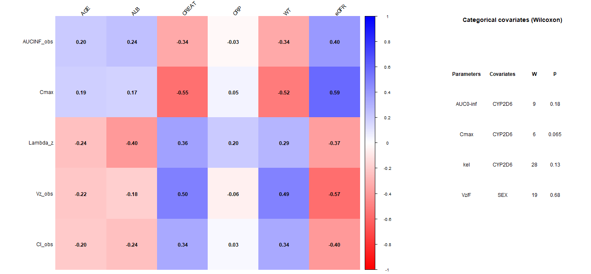{#fig-cov-heatmap}

Not all 30 correlations in @fig-cov-heatmap were interpreted, for three reasons. First, CL is calculated as Dose/AUC0-∞, so the CL row mirrors the AUC0-∞ row with the opposite sign (for example, eGFR–AUC0-∞ ρ = +0.40 and eGFR–CL ρ = −0.40) and carries no extra information. Second, weight, creatinine and eGFR all reflect body size (see the next tabs), so the intermediate associations of ke with creatinine (ρ = +0.36) and weight (ρ = +0.29), and of AUC0-∞ with weight and creatinine (ρ = −0.34), are weaker echoes of the same effect rather than independent signals: heavier participants show a lower exposure and a slightly faster elimination. Third, the remaining associations were weak (\|ρ\| ≤ 0.25) with no consistent direction. No association remained significant after correction for multiple testing.

```{r Spearman/wilcox calculation and figure creation IV}
#| eval: false
#| code-fold: true
#| code-summary: "R code: Spearman and Wilcoxon tests (IV)"


datapkanalixiv <- read.csv("NCA IV\\NCA IV\\PKanalix\\IndividualParameters\\nca\\ncaIndividualParameters.txt")
datapkanalixiv <- datapkanalixiv[-(1:2), ]
datapkanalixiv[] <- lapply(datapkanalixiv, type.convert, as.is = TRUE)

## CYP2D6 polymorphism grouped
datapkanalixiv$CYP_grp <- factor(ifelse(datapkanalixiv$CYP_2D6 %in% c(1, 2), "Fonctionnel", "Sans fonction"))

## spearman correlation
cor.test(datapkanalixiv$Cmax,   datapkanalixiv$eGFR,   method = "spearman")
cor.test(datapkanalixiv$Vz_obs, datapkanalixiv$eGFR,   method = "spearman")
cor.test(datapkanalixiv$Cmax,   datapkanalixiv$CREAT,  method = "spearman")
cor.test(datapkanalixiv$Cmax,   datapkanalixiv$WT,     method = "spearman")
cor.test(datapkanalixiv$Vz_obs, datapkanalixiv$CREAT,  method = "spearman")
cor.test(datapkanalixiv$Vz_obs, datapkanalixiv$WT,     method = "spearman")
cor.test(datapkanalixiv$AUCINF_obs, datapkanalixiv$ALB, method = "spearman")
cor.test(datapkanalixiv$AUCINF_obs,   datapkanalixiv$WT,  method = "spearman") 

cor(datapkanalixiv$ALB, datapkanalixiv$AGE) # verification of AGE effect
cor.test(datapkanalixiv$Lambda_z, datapkanalixiv$ALB, method = "spearman")
  
## CYP2D6 groups comparison
wilcox.test(datapkanalixiv$AUCINF_obs ~ datapkanalixiv$CYP_grp)
wilcox.test(datapkanalixiv$Lambda_z      ~ datapkanalixiv$CYP_grp)
wilcox.test(datapkanalixiv$Cmax          ~ datapkanalixiv$CYP_grp)
wilcox.test(datapkanalixiv$Vz_obs          ~ datapkanalixiv$SEX)


install.packages("corrplot")
library(corrplot)

## Parameters and covariates
paramsiv <- c("AUCINF_obs", "Cmax", "Lambda_z", "Vz_obs", "Cl_obs")
covsiv   <- c("AGE", "ALB", "CREAT", "CRP", "WT", "eGFR")

## Matrice rho and p-values (Spearman)
Miv <- matrix(NA, length(paramsiv), length(covsiv), dimnames = list(paramsiv, covsiv))
Piv <- Miv
for (p in paramsiv) {
  for (cv in covsiv) {
    ct <- suppressWarnings(cor.test(datapkanalixiv[[p]], datapkanalixiv[[cv]], method = "spearman"))
    Miv[p, cv] <- ct$estimate
    Piv[p, cv] <- ct$p.value
  }
}


tab <- data.frame(
  Parameters  = c("AUC0-inf", "Cmax", "kel", "Vz/F"),
  Covariates = c("CYP2D6", "CYP2D6", "CYP2D6", "SEX"),
  W = c(9, 6, 28, 19),
  p = c(0.18, 0.065, 0.13, 0.68)
)

## Combined figure creation
png("images/covariates/synthese_correlations_IV.png", width = 1400, height = 650)
layout(matrix(1:2, nrow = 1), widths = c(2.5, 1))

## 1 : the heatmap
corrplot(Miv, method = "color",
         col = rev(colorRampPalette(c("blue", "white", "red"))(200)),
         addCoef.col = "black", tl.col = "black", tl.srt = 45)

## 2 : thr table
plot.new(); plot.window(xlim = c(0, 1), ylim = c(0, 1))
title("Categorical covariates (Wilcoxon)", line = 0.5)
xs <- c(0.12, 0.42, 0.68, 0.85)
ys <- seq(0.80, 0.20, length.out = 5)
for (j in 1:4) text(xs[j], ys[1], c("Parameters","Covariates","W","p")[j], font = 2)
for (i in 1:4) for (j in 1:4) text(xs[j], ys[i + 1], as.character(tab[i, j]))

dev.off()
```

#### Body weight

::: {#fig-cov-weight-iv layout-ncol="2"}
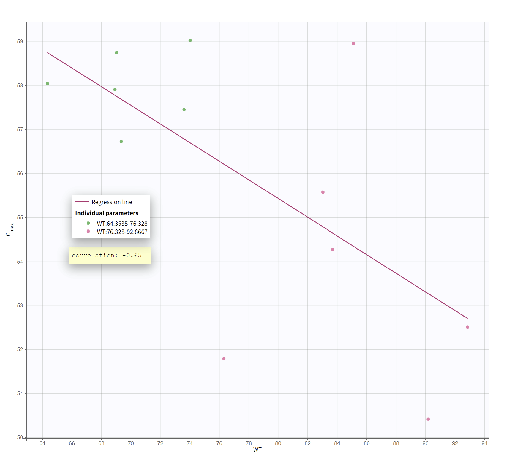

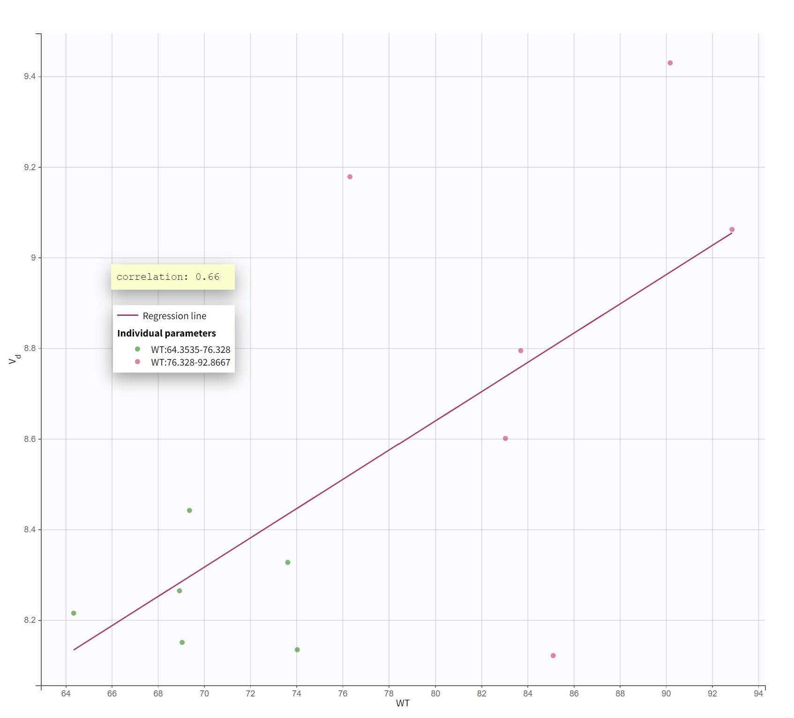

Body weight against Cmax (left) and Vz (right) after IV infusion, coloured by weight class (green: 64–76 kg; pink: 76–93 kg).
:::

Heavier participants had a lower Cmax (r = −0.65; ρ = −0.52, p = 0.089) and a larger Vz (r = +0.66; ρ = +0.49, p = 0.11) (@fig-cov-weight-iv). Neither association reached the 5% threshold, which is expected with 12 participants, where each one accounts for about 8% of the sample. The two results describe the same effect from two angles: with a fixed dose, a heavier participant has a larger volume in which the drug is diluted, and so a lower peak. This inverse relationship between weight and Cmax is expected for a drug given at a fixed dose and is the most consistent signal after IV dosing.

#### Renal markers

::: {#fig-cov-renal-iv layout-ncol="3"}
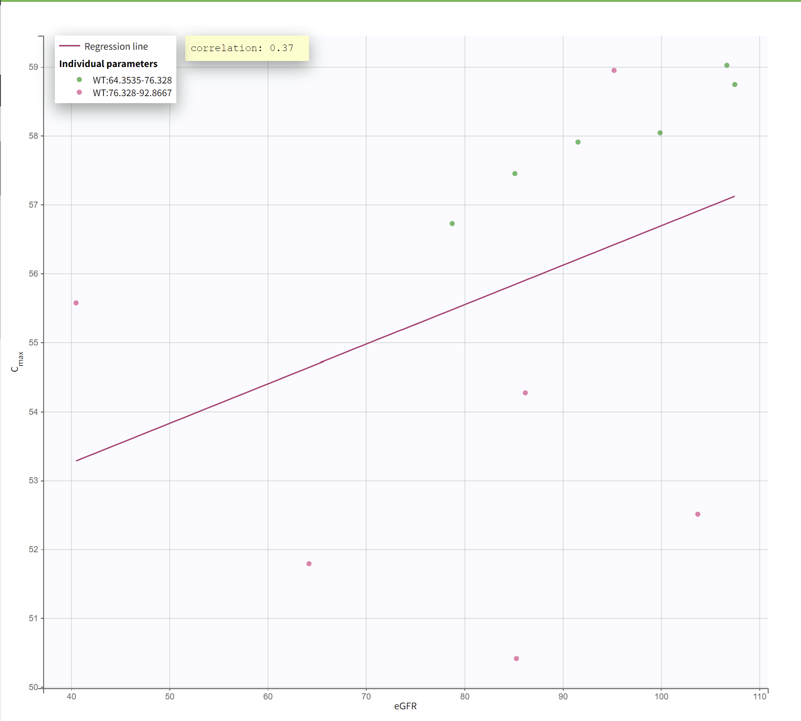

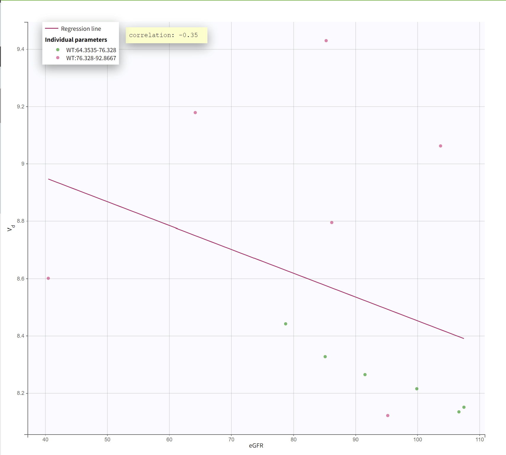

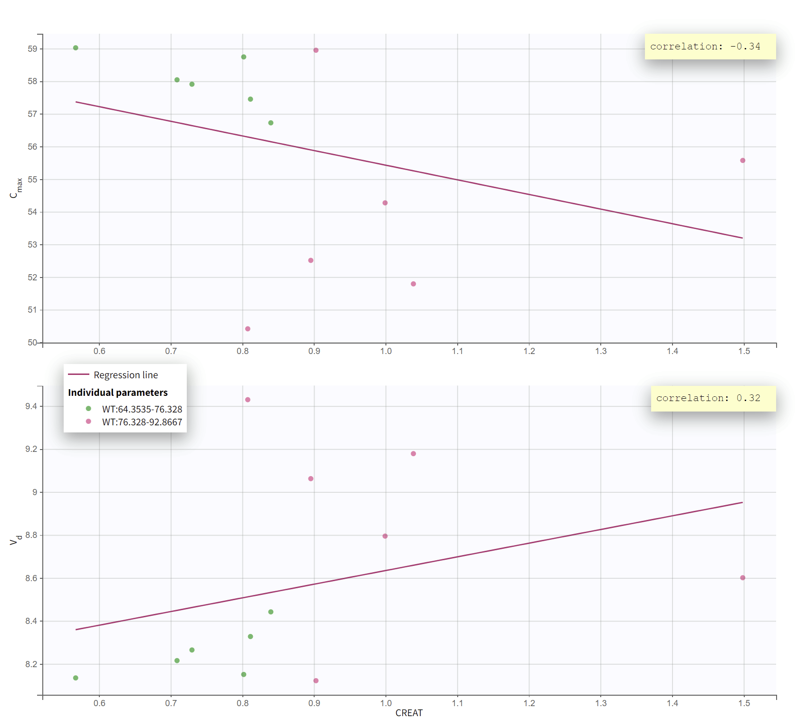

eGFR and creatinine against Cmax and Vz after IV infusion, coloured by weight class (green: 64–76 kg; pink: 76–93 kg).
:::

eGFR was positively associated with Cmax (r = 0.37; ρ = 0.59, p = 0.049, nominally significant) and negatively with Vz (r = −0.35; ρ = −0.57, p = 0.059). Creatinine showed the mirror pattern: a lower Cmax (r = −0.34; ρ = −0.55, p = 0.067) and a larger Vz (r = +0.32; ρ = +0.50, p = 0.10) at higher creatinine (@fig-cov-renal-iv). In each case ρ is stronger than r, which indicates a monotonic but not linear relationship.

These associations are unlikely to reflect a renal mechanism, because renal excretion of the drug is minimal. Colouring the points by weight class explains the pattern. At comparable eGFR or creatinine levels, lighter participants consistently had a higher Cmax and a lower Vz than heavier participants. Creatinine is a marker of muscle mass, and therefore of body size, and eGFR is calculated from it, so heavier participants tend to have higher creatinine and lower eGFR. The eGFR and creatinine associations are therefore two views of the same body-size effect, not independent confirmations, and they are attributed to body weight rather than to renal function.

#### Albumin

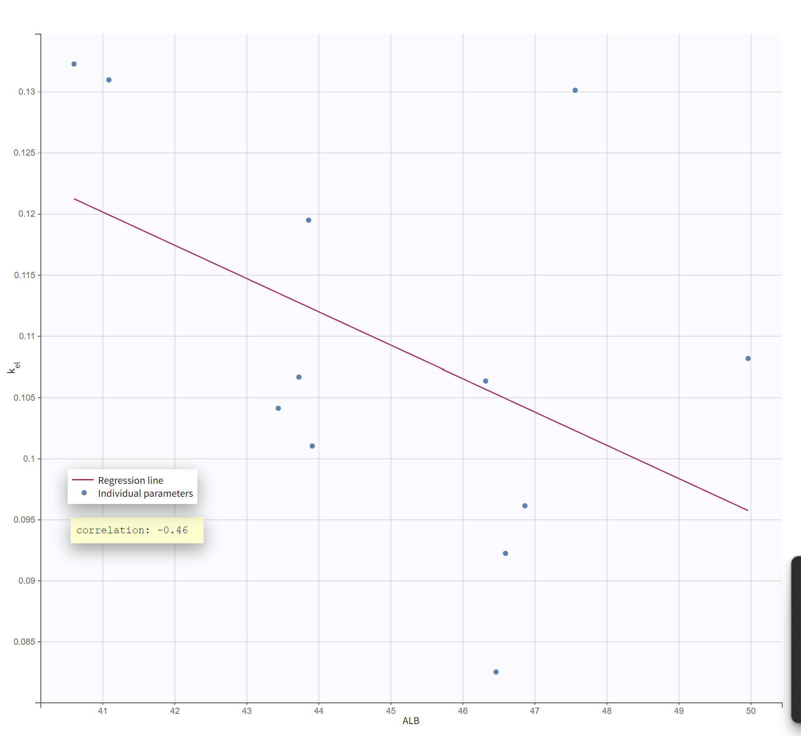{#fig-cov-alb-iv width="60%" fig-align="center"}

Participants with higher albumin tended to have a lower ke (r = −0.46; ρ = −0.40, p = 0.20) (@fig-cov-alb-iv). This result is exploratory. A plausible explanation is the high protein binding of the drug (approximately 98%, mainly to albumin): more albumin lowers the free fraction, which may slow elimination. The directions of the other albumin associations are consistent with this (CL: ρ = −0.24; AUC0-∞: ρ = +0.24; Vz: ρ = −0.18). Albumin and age were only weakly correlated (r = 0.26), so the signal is unlikely to be an effect of age on elimination.

#### CYP2D6

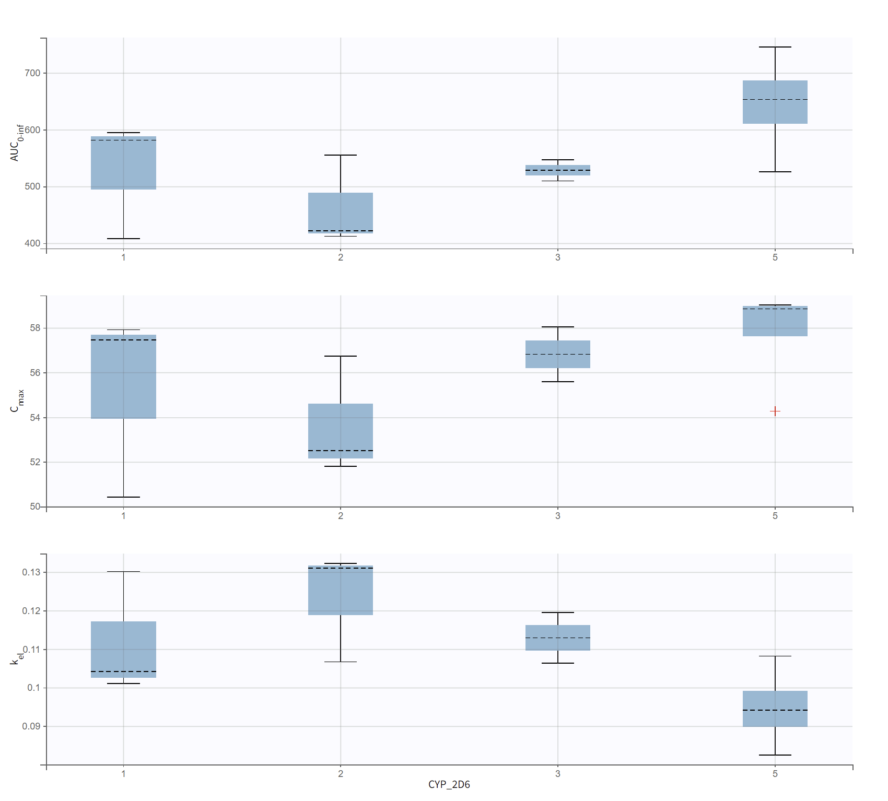{#fig-cov-cyp-iv width="60%" fig-align="center"}

Participants in categories 3 and 5 tended to have a higher AUC0-∞ and Cmax and a lower ke than those in categories 1 and 2 (@fig-cov-cyp-iv). None of the pooled comparisons reached significance: AUC0-∞ (W = 9, p = 0.18), ke (W = 28, p = 0.13) and Cmax (W = 6, p = 0.065) (@fig-cov-heatmap, right panel). The W values, however, point in the same direction for all three parameters: the functional group ranks low for AUC0-∞ and Cmax and high for ke. Participants with no-function alleles therefore tend to have higher exposure and slower elimination. This is physiologically expected, because the drug is metabolised by CYP2D6 and a less active enzyme clears it more slowly. The three parameters point in the same direction, although they are mathematically related and do not provide independent evidence.
:::::

### Oral administration

After oral dosing, the parameters also depend on bioavailability: AUC0-∞ and CL/F depend on F, Cmax depends on absorption as well as distribution and elimination, and ke (λz) describes the terminal decline rather than necessarily an isolated elimination process. CL/F is not shown separately because, at a fixed dose, CL/F = Dose/AUC0-∞, so its correlation with any covariate is identical in magnitude and opposite in sign to that of AUC0-∞. Vz/F is calculated as (CL/F)/λz, so these parameters are mathematically related and do not provide independent evidence.

::: panel-tabset
#### Overview

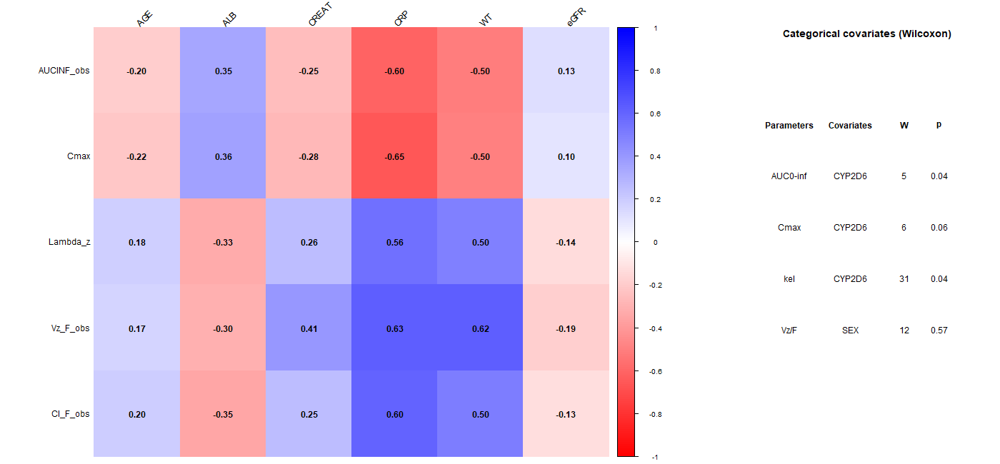{#fig-cov-heatmap-oral}

Not all 30 correlations in @fig-cov-heatmap-oral were interpreted. CRP and body weight showed the most pronounced patterns: both were negatively associated with AUC0-∞ and Cmax and positively associated with ke and Vz/F, and they are presented in the next tabs. The other continuous covariates showed weaker associations. Albumin had modest correlations with all parameters (\|ρ\| ≈ 0.30–0.36), in the same directions as after IV dosing; a contribution of protein binding is possible but not established, so these associations were not illustrated separately. Creatinine showed a moderate association with Vz/F (ρ = +0.41) but weaker ones with the other parameters, and age and eGFR were consistently weak (\|ρ\| ≤ 0.22). The CYP2D6 comparisons are presented in the last tab because of their biological relevance. The comparison of Vz/F between sexes showed no clear difference (W = 12, p = 0.57) and was not illustrated, although this does not exclude a sex effect. No association remained significant after correction for multiple testing.

```{r Spearman/wilcox calculation and figure creation ORAL}
#| eval: false
#| code-fold: true
#| code-summary: "R code: Spearman and Wilcoxon tests (oral)"

datapkanalixoral <- read.csv("NCA oral\\PKanalix\\IndividualParameters\\nca\\ncaIndividualParameters.txt",  header = TRUE)
datapkanalixoral <- datapkanalixoral[-(1:2), ]
datapkanalixoral[] <- lapply(datapkanalixoral, type.convert, as.is = TRUE)

datapkanalixoral$CYP_grp <- factor(ifelse(datapkanalixoral$CYP_2D6 %in% c(1, 2), "Fonctionnel", "Sans fonction"))

library(corrplot)

cor.test(datapkanalixoral$AUCINF_obs,   datapkanalixoral$CRP,   method = "spearman")
cor.test(datapkanalixoral$Cmax,   datapkanalixoral$CRP,   method = "spearman")
cor.test(datapkanalixoral$Lambda_z,   datapkanalixoral$CRP,   method = "spearman")
cor.test(datapkanalixoral$Vz_F_obs,   datapkanalixoral$CRP,   method = "spearman")

cor.test(datapkanalixoral$AUCINF_obs,   datapkanalixoral$WT,   method = "spearman")
cor.test(datapkanalixoral$Cmax,   datapkanalixoral$WT,   method = "spearman")
cor.test(datapkanalixoral$Lambda_z,   datapkanalixoral$WT,   method = "spearman")
cor.test(datapkanalixoral$Vz_F_obs,   datapkanalixoral$WT,   method = "spearman")

wilcox.test(datapkanalixoral$AUCINF_obs ~ datapkanalixoral$CYP_grp)
wilcox.test(datapkanalixoral$Lambda_z      ~ datapkanalixoral$CYP_grp)
wilcox.test(datapkanalixoral$Cmax          ~ datapkanalixoral$CYP_grp)
wilcox.test(datapkanalixoral$Vz_F_obs ~ datapkanalixoral$SEX)

params_oral <- c("AUCINF_obs", "Cmax", "Lambda_z", "Vz_F_obs", "Cl_F_obs")
covs_oral   <- c("AGE", "ALB", "CREAT", "CRP", "WT", "eGFR")

## Matrice rho and p-values (Spearman)
M_oral <- matrix(NA, length(params_oral), length(covs_oral), dimnames = list(params_oral, covs_oral))
P_oral <- M_oral
for (p in params_oral) {
  for (cv in covs_oral) {
    ct <- suppressWarnings(cor.test(datapkanalixoral[[p]], datapkanalixoral[[cv]], method = "spearman"))
    M_oral[p, cv] <- ct$estimate
    P_oral[p, cv] <- ct$p.value
  }
}
tab <- data.frame(
  Parametes  = c("AUC0-inf", "Cmax", "kel", "Vz/F"),
  Covariates = c("CYP2D6", "CYP2D6", "CYP2D6", "SEX"),
  W = c(5, 6, 31, 12),
  p = c(0.04, 0.06, 0.04, 0.57)
)

## Combined figure creation
png("images/covariates/synthese_correlations_oral.png", width = 1400, height = 650)
layout(matrix(1:2, nrow = 1), widths = c(2.5, 1))

## 1 : the heatmap
corrplot(M_oral, method = "color",
         col = rev(colorRampPalette(c("blue", "white", "red"))(200)),
         addCoef.col = "black", tl.col = "black", tl.srt = 45)

## 2 : the table
plot.new(); plot.window(xlim = c(0, 1), ylim = c(0, 1))
title("Categorical covariates (Wilcoxon)", line = 0.5)
xs <- c(0.12, 0.42, 0.68, 0.85)
ys <- seq(0.80, 0.20, length.out = 5)
for (j in 1:4) text(xs[j], ys[1], c("Parameters","Covariates","W","p")[j], font = 2)
for (i in 1:4) for (j in 1:4) text(xs[j], ys[i + 1], as.character(tab[i, j]))

dev.off()

```

#### CRP

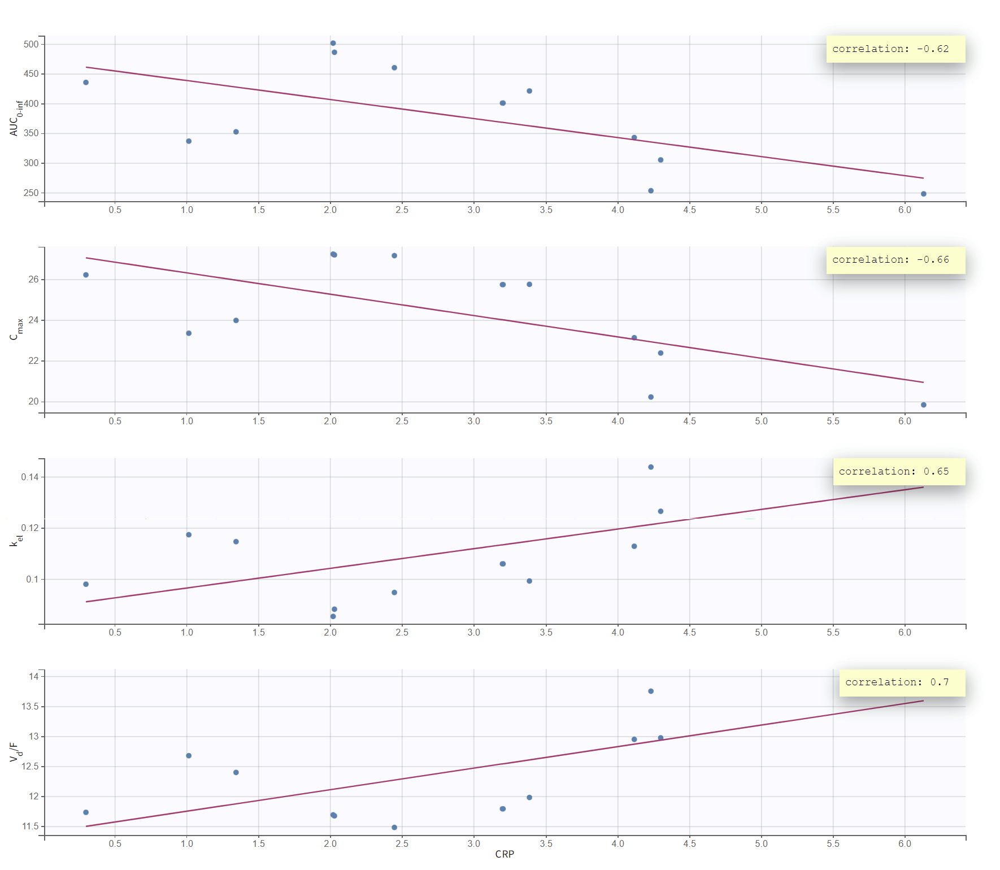{#fig-cov-crp-oral width="70%" fig-align="center"}

Higher CRP was associated with a lower AUC0-∞ (r = −0.62; ρ = −0.60, p = 0.043) and Cmax (r = −0.66; ρ = −0.65, p = 0.026), and with a higher ke (r = +0.65; ρ = +0.56, p = 0.063) and Vz/F (r = +0.70; ρ = +0.63, p = 0.032) (@fig-cov-crp-oral). The associations with AUC0-∞, Cmax and Vz/F reached the nominal 5% threshold, while the ke association remains exploratory. The linear and rank coefficients are similar, so these relationships are both monotonic and approximately linear. After IV dosing, by contrast, CRP showed only weak associations (@fig-cov-heatmap).

The four relationships are connected: lower AUC0-∞ and Cmax correspond to a higher CL/F, and Vz/F rises with it. This pattern could reflect lower oral bioavailability in participants with a higher inflammatory status, for example through inflammation-related changes in gastrointestinal absorption or first-pass processes. A lower F would reduce AUC0-∞ and Cmax and increase CL/F and Vz/F together, without any real increase in clearance or distribution volume. The results therefore suggest an effect of inflammation on oral exposure, but they remain exploratory given the small sample size.

#### Body weight

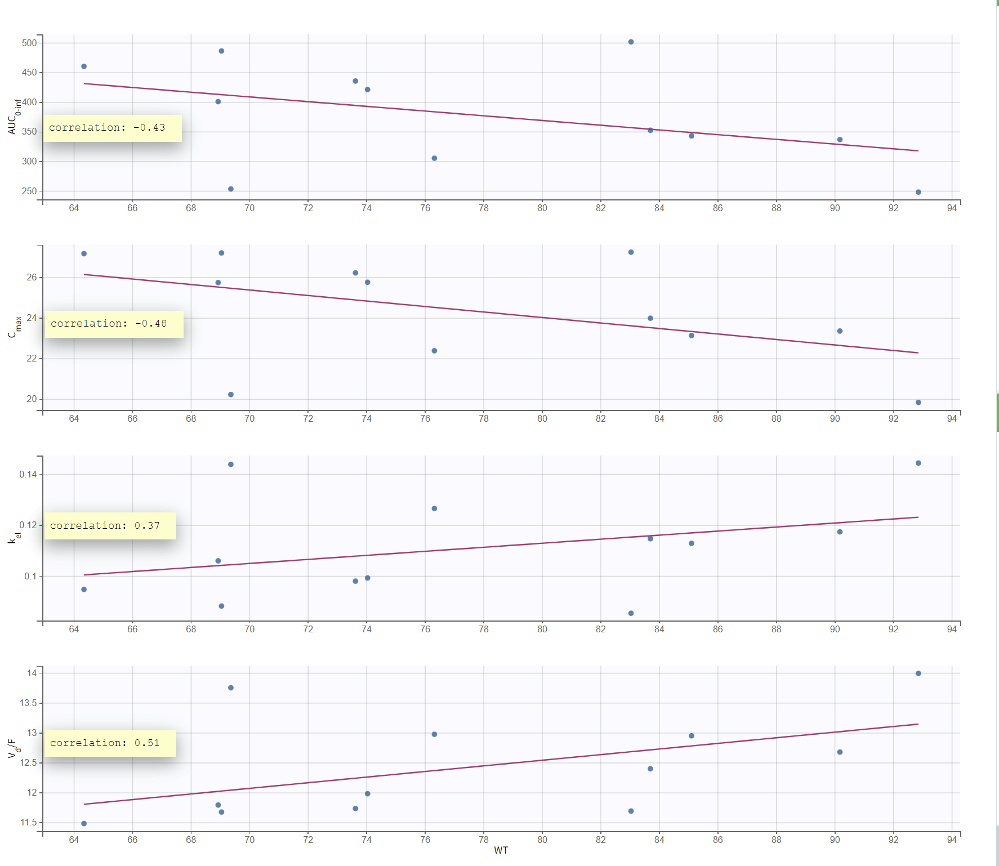{#fig-cov-weight-oral width="70%" fig-align="center"}

AUC0-∞ (ρ = −0.50, p = 0.099) and Cmax (ρ = −0.50, p = 0.104) tended to decrease with weight, while ke (ρ = +0.50, p = 0.104) and Vz/F (ρ = +0.62, p = 0.035) tended to increase (@fig-cov-weight-oral). Vz/F showed the strongest association and was the only one to reach the nominal 5% threshold. These findings remain exploratory given the small sample size and the number of associations examined.

At the same dose, the lower Cmax in heavier participants could reflect differences in distribution, although absorption and elimination may also contribute. The lower AUC0-∞ corresponds mathematically to a higher CL/F, but the oral data alone cannot show whether this reflects higher systemic clearance, lower bioavailability, or both. Overall, the graphs suggest a weight-related pattern in oral pharmacokinetics.

#### CYP2D6

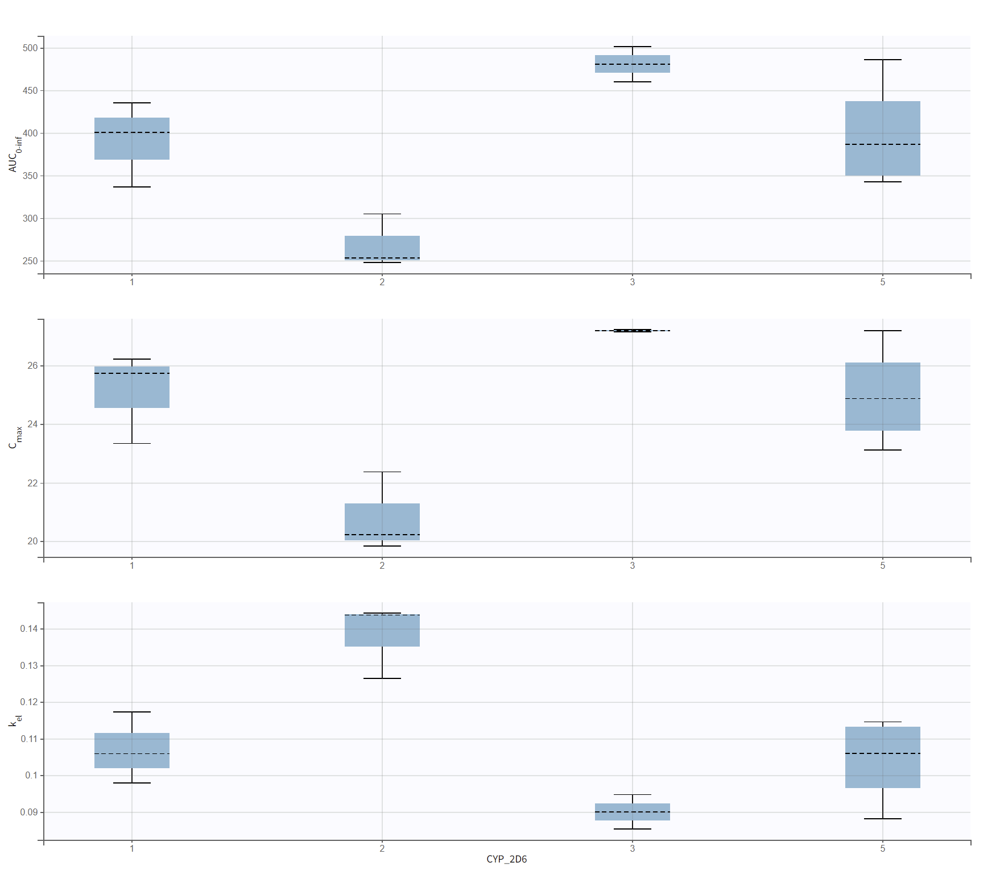{#fig-cov-cyp-oral width="60%" fig-align="center"}

Category 2 had the lowest AUC0-∞ and Cmax and the highest ke, whereas category 3 showed the opposite pattern, and categories 1 and 5 had intermediate, partly overlapping distributions (@fig-cov-cyp-oral). The differences are therefore not uniform across categories, and these box plots should be distinguished from the pooled comparisons.

In the pooled comparison, the \*3/\*5 group had a higher AUC0-∞ (W = 5, p = 0.041) and a lower ke (W = 31, p = 0.041), both reaching the nominal 5% threshold. Cmax also tended to be higher in this group, but the difference did not reach that threshold (W = 6, p = 0.065) (@fig-cov-heatmap-oral, right panel). Because CYP2D6 contributes to the clearance of the measured parent compound, higher exposure and a slower terminal decline in participants with reduced-function alleles are biologically plausible. These data do not establish that mechanism, however, because oral AUC0-∞, Cmax and ke also depend on bioavailability and absorption.
:::

**Summary** 

After IV dosing, body weight was the most consistent covariate: heavier participants had a lower Cmax and a larger Vz, and the eGFR and creatinine associations reflected body size rather than renal function. After oral dosing, CRP and body weight were associated with lower exposure and a higher Vz/F, which may partly reflect differences in bioavailability. Albumin (IV) showed a plausible but exploratory trend. Across both routes, participants with CYP2D6 categories 3 and 5 tended to have higher exposure and slower elimination, consistent with metabolism by CYP2D6.

**Limitations** 

This is an exploratory analysis in 12 participants, with low power and many associations examined. The CYP2D6 grouping assumes that the codes are star alleles classified by CPIC, and complete diplotypes are unavailable. Weight, creatinine and eGFR are related and cannot be separated, and oral parameters cannot distinguish changes in clearance from changes in bioavailability. The covariate analysis used PKanalix individual parameters, which may differ slightly from the PKNCA values in @tbl-ind-iv and @tbl-ind-oral.

## Proposed Compartmental Model

As for the covariate analysis, the dataset was split by route of administration, and a structural model was built separately for the IV infusion and the oral data. For the IV dataset, the time-zero records were adapted so that PKanalix could read them correctly: the concentration value of 0 on each dosing record was removed, so that the dose line is not interpreted as an observation, and the additional time-zero line without a measured concentration was deleted since this line gave no additional information. PKanalix encodes the resulting empty cells as missing values (".").

Candidate models were first identified from the shape of the individual concentration–time profiles. After IV infusion, concentrations peaked at the end of the infusion and then declined in a single phase, with no visible distribution phase, suggesting a one-compartment model with linear elimination. After oral dosing, concentrations rose rapidly to a peak and then declined in a single phase, with no visible delay before absorption, suggesting a one-compartment model with first-order absorption, no lag time and linear elimination. These choices were confirmed by a compartmental analysis in PKanalix: the individual fits followed the observed profiles closely and the observations versus predictions lay on the line of identity for both routes. The corresponding compartment diagrams and ordinary differential equations (ODEs) are presented below.


```{r}
#| label: model-diagram-style
#| include: false
box_fill  <- "#a5a1c6"
arrow_col <- "#5b7aa6"
arr <- arrow(length = unit(0.3, "cm"), type = "closed")
```

### IV model

The IV dose (500 mg over 0.5 h) enters the central compartment directly as a zero-order infusion at rate k0 (@fig-model-iv).

```{r}
#| label: fig-model-iv
#| fig-cap: "One-compartment model for IV infusion. k0: infusion rate; A1: amount in the central compartment; V1: volume of the central compartment; ke: elimination rate constant."
#| fig-width: 3.5
#| fig-height: 5.2
#| fig-align: center
ggplot() +
  # Central compartment
  annotate("rect", xmin = 0, xmax = 4, ymin = 0, ymax = 2,
           fill = box_fill, colour = "grey10", linewidth = 0.8) +
  annotate("text", x = 2, y = 1.45, label = "Central compartment", size = 5) +
  annotate("text", x = 2, y = 1.0, label = "A[1]", parse = TRUE, size = 5) +
  annotate("text", x = 2, y = 0.55, label = "V[1]", parse = TRUE, size = 5) +
  # Infusion
  annotate("text", x = 2, y = 4.4, label = "INFUSION", size = 5) +
  annotate("segment", x = 2, xend = 2, y = 4, yend = 2,
           colour = arrow_col, linewidth = 0.8, arrow = arr) +
  annotate("text", x = 2.15, y = 3, label = "k[0]", parse = TRUE, size = 5, hjust = 0) +
  # Elimination
  annotate("segment", x = 2, xend = 2, y = 0, yend = -1.8,
           colour = arrow_col, linewidth = 0.8, arrow = arr) +
  annotate("text", x = 2.15, y = -0.8, label = "k[e]", parse = TRUE, size = 5, hjust = 0) +
  coord_fixed(xlim = c(-0.2, 4.2), ylim = c(-2, 4.8), expand = FALSE) +
  theme_void()
```

$$
\frac{dA_1}{dt} = k_0 - k_e A_1{(t)}
$$ {#eq-iv}
$$
\frac{dA_{\mathrm{IV}}}{dt} = k_0
$$

Here, $A_{\mathrm{IV}}$ is the cumulative amount infused; $k_0$ is 1000 mg/h during the 0.5 h infusion and zero thereafter.

### Oral model

The full oral dose (500 mg) enters the gut (depot). It is absorbed into the central compartment at a rate set by ka, and only the fraction F of it reaches the central compartment (@fig-model-oral).

```{r}
#| label: fig-model-oral
#| fig-cap: "One-compartment model with first-order absorption for oral administration. Ag: amount in the gut; ka: absorption rate constant; F: bioavailability; A1: amount in the central compartment; V1: volume of distribution; ke: elimination rate constant."
#| fig-width: 7
#| fig-height: 4.6
#| fig-align: center
theta <- seq(0, 2 * pi, length.out = 200)

ggplot() +
  # Gut (depot)
  annotate("polygon", x = 1.5 + cos(theta), y = 1 + sin(theta),
           fill = box_fill, colour = "grey10", linewidth = 0.8) +
  annotate("text", x = 1.5, y = 1.4, label = "Depot", size = 5) +
  annotate("text", x = 1.5, y = 1.0, label = "(gut)", size = 5) +
  annotate("text", x = 1.5, y = 0.6, label = "A[g]", parse = TRUE, size = 5) +
  # Central compartment
  annotate("rect", xmin = 4.8, xmax = 9, ymin = 0, ymax = 2.2,
           fill = box_fill, colour = "grey10", linewidth = 0.8) +
  annotate("text", x = 6.9, y = 1.55, label = "Central compartment", size = 5) +
  annotate("text", x = 6.9, y = 1.1, label = "A[1]", parse = TRUE, size = 5) +
  annotate("text", x = 6.9, y = 0.65, label = "V[1]", parse = TRUE, size = 5) +
  # Dose into gut
  annotate("text", x = 0.4, y = 3.8, label = "Dose", size = 5) +
  annotate("segment", x = 0.5, xend = 1.15, y = 3.4, yend = 1.95,
           colour = arrow_col, linewidth = 0.8, arrow = arr) +
  # Absorption: fraction F reaches the central compartment
  annotate("segment", x = 2.5, xend = 4.8, y = 1, yend = 1,
           colour = arrow_col, linewidth = 0.8, arrow = arr) +
  annotate("text", x = 3.65, y = 1.35, label = "k[a]", parse = TRUE, size = 5) +
  annotate("text", x = 3.65, y = 0.6, label = "F <= 1", parse = TRUE, size = 5) +
  # Elimination
  annotate("segment", x = 6.9, xend = 6.9, y = 0, yend = -1.8,
           colour = arrow_col, linewidth = 0.8, arrow = arr) +
  annotate("text", x = 7.05, y = -0.8, label = "k[e]", parse = TRUE, size = 5, hjust = 0) +
  coord_fixed(xlim = c(-0.2, 9.2), ylim = c(-2, 4.2), expand = FALSE) +
  theme_void()
```

$$
\begin{aligned}
\frac{dA_g}{dt} &= -k_a A_g{(t)} \\
\frac{dA_1}{dt} &= F \, k_a A_g{(t)} - k_e A_p{(t)} \\
\end{aligned}
$$ {#eq-oral}

with $A_g(0) = \text{Dose}$ and $A_1(0) = 0$.

Absolute bioavailability was estimated from the within-participant oral-to-IV AUC ratio, as both routes used the same dose. However, the oral compartmental model was fitted separately, so its volume parameter remains an apparent volume (V1/F) unless F is fixed to the previously estimated value.


# Conclusions

This Phase I two-sequence, two-period crossover study characterised the pharmacokinetics (PK) of a novel tamoxifen-like prodrug, Tomovicen, of 500 mg given as a 0.5 h intravenous infusion and orally in 12 participants. The non-compartmental analysis, of the dataset cleaned, showed that the compound is well absorbed, with a mean absolute bioavailability of 69% (SD 15%; geometric mean 68%; range 45–91%), meaning that about two thirds of the oral dose reaches the systemic circulation, with noticeable between-participant differences. The terminal half-life was about 6.5 h after both routes (IV 6.48 ± 0.96 h; oral 6.43 ± 1.1 h; ratio 1.00, 95% CI 0.90–1.10), without evidence of flip-flop kinetics, and the IV clearance (0.96 L/h) and volume of distribution (8.7 L) were low and little variable. Oral Cmax (24.3 ± 2.6 mg/L) was reached at +/- 4 h. Such a half-life is much shorter than that of tamoxifen (about 7 days) and predicts negligible accumulation on once-daily dosing (accumulation ratio ≈ 1.1), with steady state reached within about one day; whether the end-of-interval concentration (about 10% of Cmax) remains above the effective level cannot be decided without a pharmacodynamic target or metabolite data, so suitability for once-daily dosing remains to be confirmed. No period or carry-over effect was detected (p = 0.87 and p = 0.30), although the power of these tests is low and the washout duration is undocumented.

In the exploratory covariate analysis, body weight was the most consistent covariate after IV dosing (heavier participants had a lower Cmax and a larger Vz), while higher CRP and body weight were associated with lower oral exposure and a higher Vz/F, possibly reflecting a lower oral bioavailability. Participants carrying the CYP2D6 *3/*5 codes tended to have higher exposure and slower elimination than *1/*2 participants (oral AUC0-∞ and ke: p = 0.041), which is consistent with a contribution of CYP2D6 to the clearance of the parent compound, but this does not hold after correction for multiple testing. Given the small sample size and the number of associations tested, these findings are hypothesis-generating only. A one-compartment model, with a zero-order infusion for the IV route and first-order absorption with bioavailability F for the oral route, is proposed to describe the data.

The next step is a population PK analysis (non-linear mixed-effects modelling) to quantify the covariate effects on clearance, volume and bioavailability. Measuring the active metabolite(s) would link CYP2D6 status to exposure and response, and a PK/PD target would settle whether once-daily dosing is adequate for Phase II.

# Declaration on the use of generative AI {.unnumbered}

The authors carried out the data management, analyses and interpretation in this report. Generative AI tools (Claude, Anthropic) were used only to improve the wording of some sections and to help write and debug parts of the R code. The authors take full responsibility for the content of this report.

# References {.unnumbered}

::: {#refs}
:::

::: {.callout-note collapse="true" title="Computational environment"}
```{r}
#| label: session
#| echo: false
sessionInfo()
```
:::
