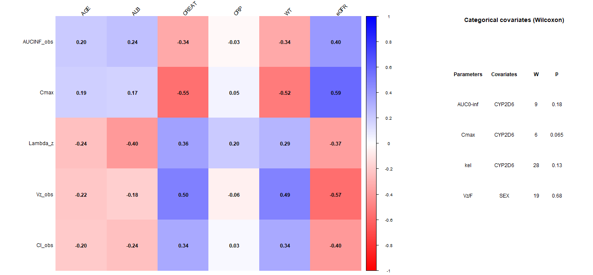

```{r}
#| label: packages
library(readxl)
library(dplyr)
library(tidyr)
library(ggplot2)
library(patchwork)
library(knitr)
library(PKNCA)
```

```{r}
#| label: settings
clean_file <- "data/clean/datIW1PMX001_CLEAN.xlsx"
route_cols <- c(IV = "#1b6ca8", Oral = "#d1495b")

as_pct  <- function(x, d = 0) paste0(round(100 * x, d), "%")
sig     <- function(x, d = 3) trimws(formatC(x, digits = d, format = "fg"))

# Lookup a summary statistic from the NCA results
# g("IV", "CL", "mean", 2)  → mean IV clearance to 2 sig figs
g <- function(route, code, stat, digits = 3) {
  r <- summary_all[summary_all$route == route & summary_all$code == code, ]
  if (nrow(r) == 0) return("–")
  sig(r[[stat]], digits)
}
```

```{r}
#| label: load-data
# Cleaned analysis dataset (data curation is documented in the dashboard)
pk <- read_excel(clean_file)
subj_clean <- pk |> distinct(ID, WT, SEX, AGE, ALB, CREAT, eGFR, CRP, CYP_2D6, ethnicity)

conc_all  <- pk |> filter(EVID %in% c(0, 4)) |> select(ID, OCC, Administration, TIME, CONC)
conc_iv   <- conc_all |> filter(Administration == "IV")
conc_oral <- conc_all |> filter(Administration == "Oral")
dose_iv   <- pk |> filter(Administration == "IV", EVID == 1) |> mutate(duration = AMT / RATE)
dose_oral <- pk |> filter(Administration == "Oral", EVID == 4)
dose_iv_mg <- unique(dose_iv$AMT); dose_oral_mg <- unique(dose_oral$AMT); infusion_h <- unique(dose_iv$duration)
mean_profile <- conc_all |> group_by(Administration, TIME) |> summarise(CONC = mean(CONC), .groups = "drop")
```

```{r}
#| label: run-nca
nca_settings <- list(auc_method = "lin up/log down", min_hl_pts = 3, min_r2 = 0.90, max_pct_extrap = 20)
pknca_opts <- list(auc.method = nca_settings$auc_method, min.hl.points = nca_settings$min_hl_pts,
                   allow.tmax.in.half.life = FALSE, min.hl.r.squared = nca_settings$min_r2)

# Parameters to calculate (TRUE = calculate), from time 0 to infinity
intervals_iv <- data.frame(start = 0, end = Inf,
  cmax = TRUE, tmax = TRUE, auclast = TRUE, aucinf.obs = TRUE, aucpext.obs = TRUE,
  lambda.z = TRUE, half.life = TRUE, r.squared = TRUE, adj.r.squared = TRUE,
  lambda.z.n.points = TRUE, lambda.z.time.first = TRUE, tlast = TRUE,
  cl.obs = TRUE, vz.obs = TRUE, aumcinf.obs = TRUE, mrt.iv.obs = TRUE, vss.iv.obs = TRUE)

intervals_oral <- data.frame(start = 0, end = Inf,
  cmax = TRUE, tmax = TRUE, auclast = TRUE, aucinf.obs = TRUE, aucpext.obs = TRUE,
  lambda.z = TRUE, half.life = TRUE, r.squared = TRUE, adj.r.squared = TRUE,
  lambda.z.n.points = TRUE, lambda.z.time.first = TRUE, tlast = TRUE,
  cl.obs = TRUE, vz.obs = TRUE, aumcinf.obs = TRUE, mrt.obs = TRUE)

nca_iv <- PKNCAdata(
  PKNCAconc(conc_iv, CONC ~ TIME | ID),
  PKNCAdose(dose_iv, AMT ~ TIME | ID, route = "intravascular", duration = "duration"),
  intervals = intervals_iv, options = pknca_opts) |>
  pk.nca()

nca_oral <- PKNCAdata(
  PKNCAconc(conc_oral, CONC ~ TIME | ID),
  PKNCAdose(dose_oral, AMT ~ TIME | ID, route = "extravascular"),
  intervals = intervals_oral, options = pknca_opts) |>
  pk.nca()

# One row per participant, with route-specific parameter names
wide_iv <- as_tibble(nca_iv$result) |>
  select(ID, PPTESTCD, PPORRES) |>
  pivot_wider(names_from = PPTESTCD, values_from = PPORRES) |>
  rename(Cmax = cmax, AUC_last = auclast, AUC_inf = aucinf.obs, pct_extrap = aucpext.obs, ke = lambda.z,
         t_half = half.life, R2 = r.squared, n_pts = lambda.z.n.points, lz_start = lambda.z.time.first,
         CL = cl.obs, Vz = vz.obs, MRT = mrt.iv.obs, Vss = vss.iv.obs)

wide_oral <- as_tibble(nca_oral$result) |>
  select(ID, PPTESTCD, PPORRES) |>
  pivot_wider(names_from = PPTESTCD, values_from = PPORRES) |>
  rename(Cmax = cmax, AUC_last = auclast, AUC_inf = aucinf.obs, pct_extrap = aucpext.obs, ke = lambda.z,
         t_half = half.life, R2 = r.squared, n_pts = lambda.z.n.points, lz_start = lambda.z.time.first,
         CL_F = cl.obs, Vz_F = vz.obs, MRT = mrt.obs)

# Terminal-phase fit quality by route
nca_quality <- bind_rows(mutate(wide_iv, Route = "IV"), mutate(wide_oral, Route = "Oral")) |>
  group_by(Route) |>
  summarise(Profiles = n(), `Min R²` = min(R2), `Max % extrapolated` = max(pct_extrap), .groups = "drop")
```

```{r}
#| label: ka-and-f
# ---- Absorption rate constant (ka): method of residuals ----
# Step 1: fit a straight line to log(concentration) in the terminal phase (from lz_start onwards).
terminal_fit <- conc_oral |>
  left_join(select(wide_oral, ID, lz_start), by = "ID") |>
  filter(TIME >= lz_start) |>
  group_by(ID) |>
  summarise(b0 = coef(lm(log(CONC) ~ TIME))[1], b1 = coef(lm(log(CONC) ~ TIME))[2], .groups = "drop")

# Step 2: extend the line back to the early points and keep the positive residuals.
residuals_early <- conc_oral |>
  left_join(select(wide_oral, ID, lz_start), by = "ID") |>
  filter(TIME > 0, TIME < lz_start) |>
  left_join(terminal_fit, by = "ID") |>
  mutate(Line = exp(b0 + b1 * TIME), residual = Line - CONC) |>
  filter(residual > 0)

# Step 3: minus the slope of log(residual) against time is ka.
ka_per_subject <- residuals_early |>
  group_by(ID) |>
  summarise(ka = -coef(lm(log(residual) ~ TIME))[2], .groups = "drop")

wide_oral <- left_join(wide_oral, ka_per_subject, by = "ID")

# ---- Absolute bioavailability (F) per participant ----
f_per_subject <- inner_join(select(wide_iv, ID, AUC_iv = AUC_inf), select(wide_oral, ID, AUC_oral = AUC_inf), by = "ID") |>
  mutate(F = (AUC_oral / dose_oral_mg) / (AUC_iv / dose_iv_mg))

# ---- Parameters to report ----
param_meta <- tribble(
  ~route, ~code,
  "IV", "Cmax", "IV", "tmax", "IV", "AUC_inf", "IV", "CL", "IV", "Vz", "IV", "Vss",
  "IV", "ke", "IV", "t_half", "IV", "MRT",
  "Oral", "Cmax", "Oral", "tmax", "Oral", "AUC_inf", "Oral", "CL_F", "Oral", "Vz_F",
  "Oral", "ka", "Oral", "ke", "Oral", "t_half", "Oral", "MRT",
  "Both", "F")

params_long <- bind_rows(mutate(wide_iv, route = "IV"), mutate(wide_oral, route = "Oral"),
                         mutate(select(f_per_subject, ID, F), route = "Both")) |>
  pivot_longer(-c(route, ID), names_to = "code", values_to = "value") |>
  semi_join(param_meta, by = c("route", "code"))

# ---- Summary statistics per parameter and route ----
summary_all <- params_long |>
  group_by(route, code) |>
  summarise(n = n(), mean = mean(value), sd = sd(value),
            median = median(value), q1 = quantile(value, 0.25), q3 = quantile(value, 0.75),
            min = min(value), max = max(value), gmean = exp(mean(log(value))), .groups = "drop")

# Once-daily dosing (24 h interval), based on the mean elimination rate constant
accum_ratio_24h <- 1 / (1 - exp(-mean(wide_iv$ke) * 24))
trough_fraction <- exp(-mean(wide_iv$ke) * 24)
```

# Abstract {.unnumbered}

**Background** 

Tomovicen (PMX001) is an investigational tamoxifen-like prodrug developed to overcome the limitations of tamoxifen, including its CYP2D6-dependent activation and high inter-individual pharmacokinetic (PK) variability. 

**Methods** 

Twelve healthy adults (`r sum(subj_clean$SEX == 0)` female; aged `r round(min(subj_clean$AGE))`–`r round(max(subj_clean$AGE))` years) received `r dose_iv_mg` mg as a `r sig(infusion_h, 2)` h intravenous (IV) infusion and `r dose_oral_mg` mg orally in a two-period crossover. PK parameters were derived by non-compartmental analysis (NCA) in PKNCA and PKanalix; a covariate screening and a proposed compartmental model were also assessed. 

**Results.** 

Clearance was low (CL `r g("IV", "CL", "mean", 2)` ± `r g("IV", "CL", "sd", 2)` L/h) and distribution limited (Vz `r g("IV", "Vz", "mean", 2)` ± `r g("IV", "Vz", "sd", 2)` L), yielding a half-life of `r g("IV", "t_half", "mean", 2)` ± `r g("IV", "t_half", "sd", 2)` h. Mean absolute bioavailability was `r as_pct(mean(f_per_subject$F))` (range `r as_pct(min(f_per_subject$F))`–`r as_pct(max(f_per_subject$F))`). Body weight and CYP2D6 subtype were the most consistent covariates, and a one-compartment model was selected for both routes. 

**Conclusion.** 

Tomovicen is moderately bioavailable with a short half-life, predicting negligible once-daily accumulation. Suitability for once-daily dosing requires metabolite measurement and a pharmacodynamic target.

# Introduction

Tamoxifen is a selective oestrogen receptor modulator (SERM) widely used in hormone-sensitive breast cancer, yet three pharmacological features limit its clinical use. First, it is a prodrug that depends on CYP2D6—a highly polymorphic enzyme—to form its main active metabolite, endoxifen; poor metabolisers and patients receiving strong CYP2D6 inhibitors show approximately 75% lower endoxifen concentrations, reducing efficacy. Second, tamoxifen is more than 99% protein-bound and is administered only orally, so its absolute bioavailability, systemic clearance and volume of distribution cannot be determined without an intravenous reference. Third, its terminal elimination half-lives are very long (≈ 7 days for the parent, ≈ 14 days for N-desmethyltamoxifen), meaning steady state is reached over weeks, dose changes act slowly, and CYP2D6-driven inter-individual variability in exposure is amplified over time into a wide distribution of endoxifen concentrations. Together, these features make dose individualisation and the definition of a reliable therapeutic window difficult in practice.

Tomovicen (PMX001) is designed to address these limitations while retaining the anti-oestrogenic mechanism of action. This Phase I two-sequence, two-period crossover study in healthy volunteers determined the absolute oral bioavailability and primary PK parameters of the parent compound, providing the foundation for dose selection in Phase II.

# Methods

**Study design** 

Twelve participants received `r dose_iv_mg` mg Tomovicen as a `r sig(infusion_h, 2)` h IV infusion and `r dose_oral_mg` mg orally in a randomised sequence, separated by a washout of undocumented length. Plasma samples were collected at 17–18 nominal time points from 0.5 to 96 h after each dose.

**Data management** 

The raw dataset (one Excel sheet per participant) was audited and curated without modifying the source file; all anomalies and their resolutions are documented in the companion [interactive dashboard report](https://github.com/nangosyah/pharmacometrics-integrative-works/blob/main/integrative-one/integrative-one-reports/PMX001_dashboard.html). Data management followed the FAIR principles [@inker]: scripted transformations, a variable dictionary and version-controlled code support findability, accessibility, interoperability and reusability.

**Pharmacokinetic analysis** 

NCA was performed with PKNCA [@pknca] in R (version `r paste(R.version$major, R.version$minor, sep = ".")`). AUC was computed by the linear-up/log-down trapezoidal rule; the terminal rate constant (λz) was estimated by log-linear regression on ≥ 3 post-peak points (R² ≥ 0.90; extrapolated area ≤ 20%). The absorption rate constant (ka) was derived by the method of residuals and the absolute bioavailability (F) as the within-participant dose-normalised AUC ratio. Compartmental analysis was performed in MonolixSuite PKanalix 2024R1. Covariate screening used Spearman rank correlation for continuous covariates and the Wilcoxon rank-sum test for categorical covariates; a value was considered statistically significant when p < 0.05.

# Results

## Baseline characteristics


| Characteristic | Mean | SD | Range | n (%) |
|:---------------|-----:|---:|:-----:|------:|
| Age (years) | 56.8 | 4.6 | 50.3–64.4 | |
| Weight (kg) | 77.6 | 9.2 | 64.4–92.9 | |
| eGFR (mL/min/1.73 m²) | 87.1 | 19.3 | 40.5–107.5 | |
| Albumin (g/L) | 45.0 | 2.7 | 40.6–50.0 | |
| CRP (mg/L) | 2.9 | 1.7 | 0.3–6.1 | |
| **Sex** | | | | |
| Female | | | | 8 (67%) |
| Male | | | | 4 (33%) |
| **CYP2D6 subtype (code)** | | | | |
| 1(functional) | | | | 3 (25%) |
| 2(functional) | | | | 3 (25%) |
| 3(non-functional) | | | | 2 (17%) |
| 5(non-functional) | | | | 4 (33%) |
| **Ethnicity** | | | | |
| Asian | | | | 3 (25%) |
| Black | | | | 3 (25%) |
| Other | | | | 3 (25%) |
| White | | | | 3 (25%) |

: Baseline characteristics (n = 12). Continuous variables: mean, SD and range; categorical variables: n (%). {#tbl-baseline-report}


The 12 participants were middle-aged adults with mean body weight `r round(mean(subj_clean$WT), 1)` kg and mean eGFR `r round(mean(subj_clean$eGFR), 1)` mL/min/1.73 m²; one participant had markedly reduced renal function (eGFR `r round(min(subj_clean$eGFR), 1)` mL/min/1.73 m²). Eight participants were female and four male, balanced across the two treatment sequences. All continuous covariates were consistent with normality (Shapiro–Wilk p > 0.09) except creatinine (p = 0.04), which was influenced by the same participant. Each CYP2D6 subtype and ethnic group contained only two to four participants, limiting subgroup comparisons.

## Non-compartmental analysis

```{r}
#| label: fig-profiles-report
#| fig-cap: "Plasma concentration–time profiles after 500 mg IV infusion and 500 mg oral dose (semi-logarithmic scale). Thin lines: individual participants; thick lines: arithmetic mean."
#| fig-height: 2.4
#| fig-width: 6.5
ggplot(filter(conc_all, CONC > 0), aes(TIME, CONC, colour = Administration)) +
  geom_line(aes(group = interaction(ID, Administration)), alpha = 0.3) +
  geom_line(data = filter(mean_profile, CONC > 0), linewidth = 1) +
  scale_y_log10() +
  scale_colour_manual(values = route_cols) +
  labs(x = "Time (h)", y = "Concentration (mg/L)", colour = NULL) +
  theme_bw(base_size = 9) +
  theme(panel.grid.minor = element_blank(), legend.position = "right")
```

All `r 2 * n_distinct(pk$ID)` profiles met the acceptance criteria (R² ≥ `r sig(min(nca_quality[["Min R²"]]), 4)`; extrapolated area < 0.04%). After IV infusion, concentrations declined as a single log-linear phase with no visible distribution phase, indicating one-compartment disposition. After oral dosing, concentrations peaked at approximately 4 h and the terminal slope was parallel to the IV curve, confirming first-order absorption without flip-flop kinetics.


```{r}
#| label: tbl-pk-report
#| tbl-cap: "Pharmacokinetic parameters of Tomovicen after 500 mg IV infusion and 500 mg oral dose (n = 12). Mean ± SD (CV%); tmax: median [IQR]; F: within-subject dose-normalised AUC ratio."
make_row <- function(label, route, code) {
  r <- summary_all[summary_all$route == route & summary_all$code == code, ]
  if (nrow(r) == 0) return(c(label, "–", "–", "–", "–"))
  if (code == "tmax") {
    return(c(label,
             paste0(sig(r$median, 2), " [", sig(r$q1, 2), "–", sig(r$q3, 2), "]"),
             "–", "–", paste0(sig(r$min, 2), "–", sig(r$max, 2))))
  }
  cv_pct <- if (!is.na(r$mean) && r$mean != 0) sprintf("%.0f", 100 * r$sd / r$mean) else "–"
  c(label,
    paste0(sig(r$mean, 3), " ± ", sig(r$sd, 2)),
    cv_pct,
    sig(r$gmean, 3),
    paste0(sig(r$min, 3), "–", sig(r$max, 3)))
}

pk_tab <- as.data.frame(rbind(
  c("**IV infusion**",                "",    "",    "",    ""),
  make_row("  Cmax (mg/L)",           "IV",  "Cmax"),
  make_row("  tmax (h)",              "IV",  "tmax"),
  make_row("  AUC0-inf (mg.h/L)",    "IV",  "AUC_inf"),
  make_row("  CL (L/h)",             "IV",  "CL"),
  make_row("  Vz (L)",               "IV",  "Vz"),
  make_row("  Vss (L)",              "IV",  "Vss"),
  make_row("  t1/2 (h)",             "IV",  "t_half"),
  make_row("  MRT (h)",              "IV",  "MRT"),
  c("**Oral**",                      "",    "",    "",    ""),
  make_row("  Cmax (mg/L)",          "Oral","Cmax"),
  make_row("  tmax (h)",             "Oral","tmax"),
  make_row("  AUC0-inf (mg.h/L)",   "Oral","AUC_inf"),
  make_row("  CL/F (L/h)",          "Oral","CL_F"),
  make_row("  Vz/F (L)",            "Oral","Vz_F"),
  make_row("  ka (1/h)",            "Oral","ka"),
  make_row("  t1/2 (h)",            "Oral","t_half"),
  make_row("  MRT (h)",             "Oral","MRT"),
  c("**Bioavailability**",           "",    "",    "",    ""),
  make_row("  F",                   "Both","F")
))
colnames(pk_tab) <- c("Parameter", "Mean +/- SD", "CV%", "Geom. mean", "Range")
knitr::kable(pk_tab, row.names = FALSE)
```

The compound shows **low clearance** (CL `r g("IV","CL","mean",2)` L/h, ≈ 1% of hepatic blood flow), making exposure sensitive to enzyme activity rather than blood flow. Volume of distribution was limited (Vz ≈ Vss ≈ `r g("IV","Vz","mean",2)` L, well below total body water), unlike tamoxifen. The half-life was the same by both routes (`r g("IV","t_half","mean",2)` vs `r g("Oral","t_half","mean",2)` h; ratio 1.00, 95% CI 0.90–1.10), with no period or carry-over effect (p > 0.25). Between-subject variability was moderate for clearance and exposure (CV 19–25%) but low for volume (≈ 5%). With once-daily dosing the accumulation ratio would be `r sig(accum_ratio_24h, 3)`, with trough concentrations at approximately `r as_pct(trough_fraction)` of peak.

## Absolute bioavailability

```{r}
#| label: fig-bioav-report
#| fig-cap: "Absolute oral bioavailability (F) per participant (ranked). Dashed line: arithmetic mean."
#| fig-height: 2.2
#| fig-width: 4.5
#| fig-align: center
ggplot(f_per_subject, aes(reorder(factor(ID), F), F)) +
  geom_col(fill = "grey65") +
  geom_hline(yintercept = mean(f_per_subject$F), linetype = 2, colour = "firebrick") +
  scale_y_continuous(labels = scales::percent_format(), limits = c(0, 1)) +
  labs(x = "Participant", y = "F") +
  theme_bw(base_size = 9)
```

Mean absolute oral bioavailability was `r as_pct(mean(f_per_subject$F))` (SD `r as_pct(sd(f_per_subject$F))`; range `r as_pct(min(f_per_subject$F))`–`r as_pct(max(f_per_subject$F))`). Every participant showed lower oral than IV exposure (all lines slope downward in within-participant comparisons), and F varied noticeably between individuals. Approximately one third of the oral dose is lost to incomplete absorption or first-pass metabolism, which may include CYP2D6-mediated conversion to the active metabolite.

## Covariate pilot analysis

Covariate relationships were explored separately for IV infusion and oral administration using individual NCA parameters from PKanalix. Visual inspection of covariate–parameter plots was complemented by Spearman rank correlations for continuous covariates and Wilcoxon rank-sum tests for categorical covariates, calculated in R. CYP2D6 categories {1,2} and {3,5} were pooled, conditional on the dataset codes representing the corresponding normal-function and no-function star alleles. Findings were interpreted according to association strength, consistency across related parameters and biological plausibility, rather than nominal p-values alone.

```{r}
#| label: fig-cov-report
#| fig-cap: "Spearman rank correlation (\\u03c1) between IV PK parameters(left ), Oral PK parameters(right) and continuous covariates."
#| fig-width: 5.5
#| fig-height: 3.0
#| fig-align: center

```

After **IV dosing**, body weight was the most consistent covariate: heavier participants had lower Cmax (Spearman ρ = −0.52) and larger Vz (ρ = +0.49). The eGFR and creatinine associations may partly reflect body-size differences rather than a direct renal effect. A plausible albumin–ke association (ρ = −0.40) may reflect protein-binding effects on clearance. After **oral dosing**, higher CRP was associated with lower AUC₀₋∞ (ρ = −0.60, p = 0.043) and Cmax (ρ = −0.65, p = 0.026), potentially reflecting inflammation-related changes in oral bioavailability. Across both routes, the pooled CYP2D6 {3,5} group tended to have higher exposure and a slower terminal decline than the {1,2} group; the pooled comparison reached nominal significance for oral AUC₀₋∞ and ke (p = 0.041), consistent with CYP2D6 contribution to clearance. These findings remain exploratory given the small sample size and the number of associations examined.


## Proposed compartmental model

```{r}
#| label: fig-models-report
#| fig-cap: "One-compartment model diagrams. Left — IV: zero-order infusion (k0) with first-order elimination (ke). Right — Oral: first-order absorption (ka) with bioavailability fraction F and first-order elimination (ke)."
#| fig-height: 2.8
#| fig-width: 6.2
box_fill  <- "#a5a1c6"
arrow_col <- "#5b7aa6"
arr <- arrow(length = unit(0.25, "cm"), type = "closed")

p_iv <- ggplot() +
  annotate("rect", xmin = 0, xmax = 4, ymin = 0, ymax = 2,
           fill = box_fill, colour = "grey20", linewidth = 0.7) +
  annotate("text", x = 2, y = 1.25, label = "Central", size = 3.2) +
  annotate("text", x = 2, y = 0.75, label = "A[1]*','~V[1]", parse = TRUE, size = 3.2) +
  annotate("text", x = 2, y = 4.2, label = "IV INFUSION", size = 3.2) +
  annotate("segment", x = 2, xend = 2, y = 3.8, yend = 2.1,
           colour = arrow_col, linewidth = 0.8, arrow = arr) +
  annotate("text", x = 2.2, y = 3.0, label = "k[0]", parse = TRUE, size = 3.2, hjust = 0) +
  annotate("segment", x = 2, xend = 2, y = 0.1, yend = -1.5,
           colour = arrow_col, linewidth = 0.8, arrow = arr) +
  annotate("text", x = 2.2, y = -0.6, label = "k[e]", parse = TRUE, size = 3.2, hjust = 0) +
  coord_fixed(xlim = c(-0.5, 4.5), ylim = c(-2.0, 4.7), expand = FALSE) +
  ggtitle("IV model") +
  theme_void(base_size = 9)

theta <- seq(0, 2 * pi, length.out = 200)
p_oral <- ggplot() +
  annotate("polygon", x = 1.2 + 0.9 * cos(theta), y = 1 + 0.9 * sin(theta),
           fill = box_fill, colour = "grey20", linewidth = 0.7) +
  annotate("text", x = 1.2, y = 1, label = "Depot\nAg", size = 2.9, lineheight = 1.1) +
  annotate("rect", xmin = 3.6, xmax = 7.2, ymin = 0, ymax = 2,
           fill = box_fill, colour = "grey20", linewidth = 0.7) +
  annotate("text", x = 5.4, y = 1.25, label = "Central", size = 3.2) +
  annotate("text", x = 5.4, y = 0.75, label = "A[1]*','~V[1]", parse = TRUE, size = 3.2) +
  annotate("text", x = 0.3, y = 3.8, label = "Dose", size = 3.2) +
  annotate("segment", x = 0.4, xend = 0.85, y = 3.4, yend = 1.8,
           colour = arrow_col, linewidth = 0.8, arrow = arr) +
  annotate("segment", x = 2.1, xend = 3.7, y = 1, yend = 1,
           colour = arrow_col, linewidth = 0.8, arrow = arr) +
  annotate("text", x = 2.9, y = 1.4, label = "k[a]", parse = TRUE, size = 2.9) +
  annotate("text", x = 2.9, y = 0.5, label = "F", size = 2.9) +
  annotate("segment", x = 5.4, xend = 5.4, y = 0.1, yend = -1.5,
           colour = arrow_col, linewidth = 0.8, arrow = arr) +
  annotate("text", x = 5.6, y = -0.6, label = "k[e]", parse = TRUE, size = 3.2, hjust = 0) +
  coord_fixed(xlim = c(-0.5, 7.7), ylim = c(-2.0, 4.5), expand = FALSE) +
  ggtitle("Oral model") +
  theme_void(base_size = 9)

p_iv + p_oral
```

$$
\frac{dA_1}{dt} = k_0 - k_e A_1{(t)}
$$ {#eq-iv}
  
  
$$
\frac{dA_{\mathrm{IV}}}{dt} = k_0
$$
  
Here, $A_{\mathrm{IV}}$ is the cumulative amount infused; $k_0$ is 1000 mg/h during the 0.5 h infusion and zero thereafter.  

$$
\begin{aligned}
\frac{dA_g}{dt} &= -k_a A_g{(t)} \\
\frac{dA_1}{dt} &= F \, k_a A_g{(t)} - k_e A_p{(t)} \\
\end{aligned}
$$ {#eq-oral}

with $A_g(0) = \text{Dose}$ and $A_1(0) = 0$.

Individual concentration–time profiles after IV infusion showed a single log-linear decline with Vz = Vss, supporting a one-compartment structural model with linear elimination. Oral profiles declined in parallel to the IV curve, confirming first-order absorption without a lag time. A one-compartment model with zero-order infusion (IV) and first-order absorption with bioavailability F (oral) was fitted in PKanalix; individual fits lay close to the line of identity for both routes, validating the structural choice. Initial parameter estimates taken from Table 2 confirmed good convergence.

# Discussion

Only the parent compound was measured in this study. Tomovicen is designed as a prodrug, and the active moiety responsible for anti-oestrogenic effect has not been identified or quantified. Without metabolite data it is not possible to confirm CYP2D6-mediated activation, to link exposure of the parent to pharmacodynamic effect, or to judge whether the trough concentration at 24 h (approximately `r as_pct(trough_fraction)` of peak for once-daily dosing) remains above an efficacious level. Second, the high degree of protein binding characteristic of tamoxifen-like structures may also apply to Tomovicen; if protein binding is substantial, free (pharmacologically active) drug concentrations will differ from total plasma concentrations, and inter-individual variability in albumin could produce clinically relevant differences in free exposure. Third, the washout duration between periods is undocumented, so carry-over cannot be formally excluded although both the period and carry-over tests were non-significant (p > 0.25). Finally, suitability for once-daily dosing cannot be confirmed on PK grounds alone without a pharmacodynamic target concentration for the relevant active species.

**Limitations** 

The sample of 12 participants provides low statistical power; many of the covariate associations identified are likely to reflect chance rather than true effects. CYP2D6 subtype, sex and ethnicity are partially confounded, so these covariates cannot be assessed independently. The CYP2D6 grouping assumed that the numeric codes correspond to specific star alleles under the CPIC classification, which was not verified. The absorption rate constant (ka) from the method of residuals was implausibly uniform across participants (CV < 1%), suggesting overestimation. Concentration data for three participants relied on scale corrections not yet confirmed by the data manager. The covariate analysis used individual parameters from PKanalix, which may differ slightly from the PKNCA values in Table 2.

# Conclusion

Tomovicen displays low clearance (`r g("IV","CL","mean",2)` L/h), limited volume of distribution (Vz = Vss = `r g("IV","Vz","mean",2)` L) and a half-life of approximately `r g("IV","t_half","mean",2)` h substantially shorter than tamoxifen. Mean absolute oral bioavailability was `r as_pct(mean(f_per_subject$F))` with moderate between-subject variability (CV `r sprintf("%.0f", 100 * sd(f_per_subject$F) / mean(f_per_subject$F))`%), and negligible accumulation is expected with once-daily dosing (accumulation ratio `r sig(accum_ratio_24h, 3)`). Body weight and CYP2D6 subtype were identified as the most relevant covariates, and a one-compartment model with first-order elimination and absorption adequately described the data. The next steps are a population PK analysis to quantify covariate effects on clearance and bioavailability, measurement of the active metabolite(s) to confirm CYP2D6 activation and establish an exposure–response relationship, and definition of a pharmacodynamic target before proceeding to Phase II. All analyses are fully reproducible from the companion [interactive dashboard report](https://github.com/nangosyah/pharmacometrics-integrative-works/blob/main/integrative-one/integrative-one-reports/PMX001_dashboard.html), which documents every data-handling step and output in accordance with FAIR principles.

# References {.unnumbered}

::: {#refs}
:::
